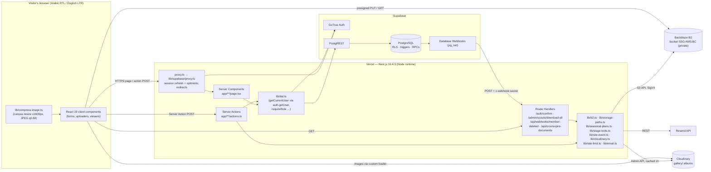
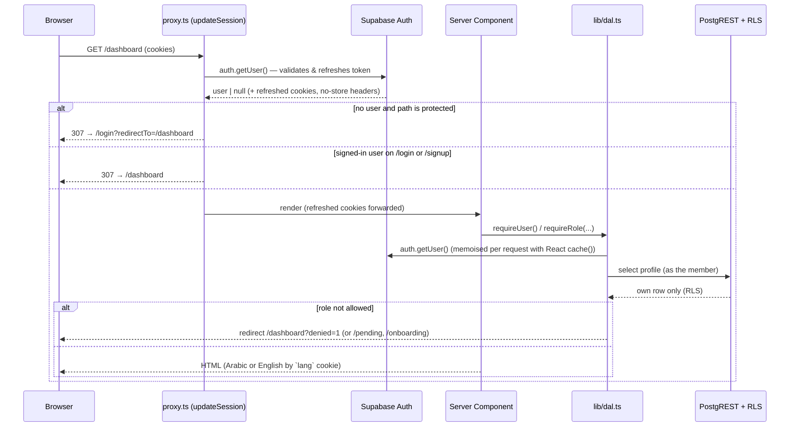
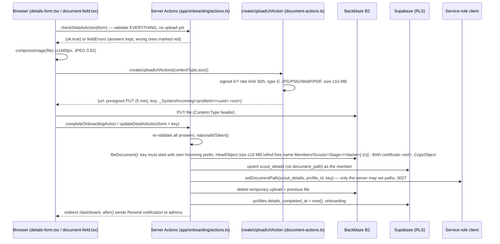
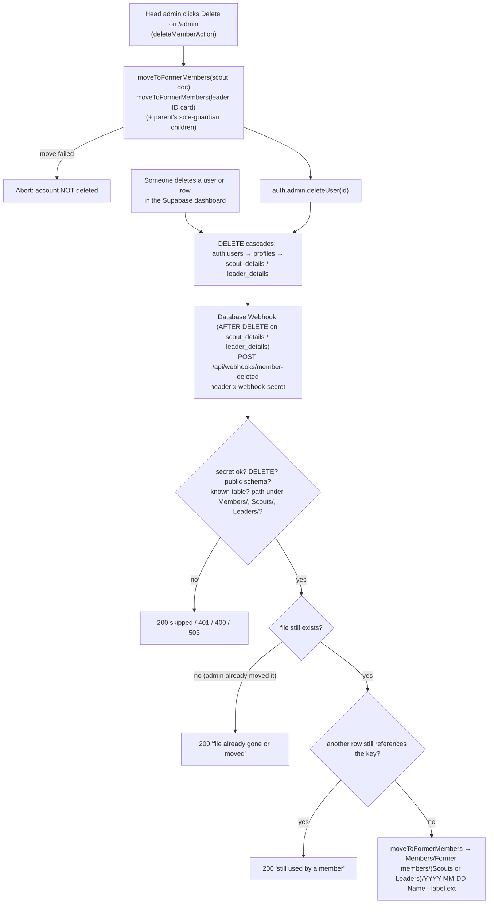
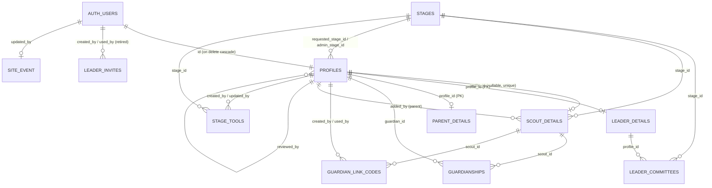

# El-Salam Scouting Group — Website & Association Management System (SSG-Website-AMS)

## Technical Project Report

| | |
|---|---|
| **Repository** | `github.com/joe02692/SSG_website_AMS` (branch `main`) |
| **Production URL** | `https://ssg-website-ams.vercel.app` (custom domain pending purchase on Cloudflare) |
| **Report date** | 1 November 2026 (launch day) |
| **Code version at time of writing** | `V1.8.1` (commit `2816db2`, merged as `60a25ab`) |
| **Development window covered** | ~August 2026 → 1 November 2026 (≈3 months) |
| **Size** | 23,048 lines across `app/`, `lib/`, `components/`, `scripts/`, `supabase/`, `proxy.ts` (TypeScript, TSX, SQL, CSS, MJS); 27 SQL migrations; 13 database tables + 2 views; 32 application database functions (31 names, one overloaded); 16 table triggers + 1 on `auth.users` |

> **Sources used for this report.** Every statement about code, schema and configuration was taken from the repository itself: source files were read directly, and the database schema was produced by replaying all 27 migrations (`0001`–`0027`) into a scratch PostgreSQL 16 instance with a Supabase-compatible shim and dumping `information_schema` / `pg_catalog`. The chronological timeline (Section 6) combines the Git history (which in this repository begins on 27 Oct 2026, when the existing codebase was imported as a single commit) with the dated engineering notes kept in the project's knowledge base (25 Aug → 1 Nov 2026) and the numbered migration sequence.

---

## 1. Executive Summary & Project Overview

### 1.1 What the system is

SSG-Website-AMS is the public website **and** the private membership-management system of **El-Salam Scouting Group (مجموعات السلام الكشفية)**, an Egyptian scout group founded in **1977 in Tanta**, operating three branches (Tanta Sports Club, Al Rehab Sports Club — founded 2010 — and Madinaty Sports Club) under the Egyptian Federation for Scouts and Girl Guides. The group organises its members into **eight scouting stages** (Buds/براعم, Blossoms/زهرات, Cubs/أشبال, Guides/مرشدات, Scouts/كشافة, Senior Guides/متقدمات, Senior Scouts/متقدم, Rovers/جوالة).

It is one Next.js application with two faces:

1. **Public website** (bilingual Arabic/English, Arabic by default, right-to-left aware): home page with a hero slideshow, "About us", the Scout Promise and the 11 articles of the Scout Law, the group's history on an illustrated "rope" timeline with every camp from 2018 to 2026, the stages page, and a photo gallery of camp albums served from Cloudinary. An event countdown card, controlled from the admin page, floats under the header.
2. **Association Management System (AMS)** behind a login: registration of scouts, leaders and parents; collection of identity documents (children's birth certificates, leaders' national-ID cards) into private object storage; a leader-request/approval workflow with a strict role hierarchy; parent accounts that register and manage children; seasonal plans (Excel files per stage, with an archive); a weekly "tools for every meeting" list per stage with a Cairo-time editing window; and a head-admin console (rosters, approvals, role changes, account deletion with document preservation, password-recovery links, event countdown editor, bulk ZIP export of certificates).

### 1.2 Core problems solved

| Problem before | How the system solves it |
|---|---|
| Registration on paper/WhatsApp; documents scattered across phones | Structured onboarding forms with database-enforced validation; documents uploaded straight from the phone, compressed in the browser and filed in a private bucket under a human-readable name (`Members/Scouts/Cubs/<Full name> - Birth certificate.jpg`). |
| Anyone claiming to be a leader | Leaders *request* a role at signup; the account is `pending_leader` and can do nothing until the single **head site admin** approves it and picks the final role. The database itself refuses any client-side role change. |
| Parents had no view of their children's records | Parent accounts (no approval needed) register young children directly or link older scouts with a one-time 8-letter code; they can view and edit only those children. PDPL-style consent is recorded. |
| Seasonal plans emailed around as Excel attachments | One current plan per stage in a private bucket, viewable as an in-page table (server-side SheetJS), downloadable through 60-second signed links; replaced plans go to a dated archive and are never deleted. |
| Forgetting meeting equipment | A per-stage weekly list of tools, editable by that stage's stage admins from Saturday 00:00 to Wednesday 23:59 Cairo time, read-only Thursday–Friday, fresh every Saturday with a "copy last week" button. |
| Deleting a member destroyed their documents | Every deletion path (the admin console, and direct deletions in the Supabase dashboard via a database webhook) moves the document to `Members/Former members/` with a date prefix first. |
| No public presence in Arabic | Full Arabic/English site, Arabic default, Noto Sans / Noto Sans Arabic, logical (RTL-safe) CSS throughout, WCAG 2.1 AA checked with axe-core. |

### 1.3 Target users and use cases

| User | Role value | Main use cases |
|---|---|---|
| Visitor (no account) | — | Read about the group, browse camp photos, see the event countdown, sign up. |
| Scout | `scout` | Complete registration (date of birth, address, phones, stage, optional national ID, birth certificate), view/replace their document, create a parent-link code. |
| Parent / guardian | `parent` | Give consent, add children (each with a birth certificate), link existing scouts by code, edit children, remove children. |
| Pending leader | `pending_leader` | Sees only `/pending` until approved; can complete leader details meanwhile. |
| Stage leader | `stage_leader` | Read every stage's seasonal plan and meeting-tools list. |
| Stage admin | `stage_admin` (+ `profiles.admin_stage_id`) | Everything a stage leader can do, plus upload/replace/archive the plan and edit the tools list **for their own stage**. Maximum two per stage (soft limit). |
| Site admin | `site_admin` | Staff access; view-only on plans. (The `/admin` console is restricted to the head site admin.) |
| Head site admin | `head_site_admin` (exactly one, set by SQL) | Approve/reject leader requests, change roles, delete accounts, issue recovery links, edit the event countdown, view rosters and documents, download all certificates as ZIP, manage any stage's plan and tools. |

### 1.4 Technology stack

All versions below are the versions **resolved in `package-lock.json`** at `V1.8.1`.

#### Languages

| Language | Where | Role |
|---|---|---|
| TypeScript 5.9.3 (strict mode, `moduleResolution: bundler`, path alias `@/*` → repo root) | `app/`, `lib/`, `components/`, `proxy.ts` | All application code. |
| TSX (React JSX, `jsx: react-jsx`) | `app/**/page.tsx`, `components/**` | UI. |
| SQL (PostgreSQL 15/16 dialect, PL/pgSQL) | `supabase/migrations/0001`–`0027`, `supabase/checks/*.sql` | Schema, Row-Level Security, triggers, RPC functions. |
| JavaScript (ES modules, `.mjs`, Node 22) | `scripts/*.mjs`, `eslint.config.mjs`, `postcss.config.mjs` | Operational scripts run locally by the administrator. |
| CSS (Tailwind CSS v4, CSS-first configuration) | `app/globals.css` | Design tokens, animations, the history "rope". |
| YAML | `.github/workflows/ci_1.yml` | Continuous integration. |

#### Runtime frameworks and libraries (production dependencies)

| Package | Version | Role in this project |
|---|---|---|
| `next` | 16.4.3 | App Router framework: Server Components, Server Actions, Route Handlers, `proxy.ts` (Next 16's replacement for `middleware.ts`, Node runtime), `next/font/google`, `next/image`, `unstable_cache`/`updateTag`/`revalidatePath`, `after()`, metadata routes (`robots.ts`, `sitemap.ts`, `manifest.ts`, `opengraph-image.jpg`). Upgraded from 16.3.7 on 1 Nov 2026 to close critical advisories. |
| `react` / `react-dom` | 19.2.8 | UI; `useActionState`, `useTransition`/`startTransition`, `useImperativeHandle`; React Compiler-aware lint rules. |
| `@supabase/supabase-js` | 2.112.4 | PostgREST queries, RPC calls, Auth (sign-up, sign-in, OTP verification, password update), Auth Admin API (`deleteUser`, `getUserById`, `generateLink`) with the service-role key. |
| `@supabase/ssr` | 0.12.5 | Cookie-bound Supabase clients for Server Components, Server Actions, Route Handlers and the proxy (`createServerClient`), and the browser client (`createBrowserClient`). |
| `@aws-sdk/client-s3` | 3.1127.0 | S3-compatible client for **Backblaze B2**: Head/Get/Put/Copy/Delete object, ListObjectsV2, ListObjectVersions. Configured with `forcePathStyle: true` and `requestChecksumCalculation: "WHEN_REQUIRED"`. |
| `@aws-sdk/s3-request-presigner` | 3.1127.0 | Presigned PUT URLs (5-minute TTL) for direct browser uploads and presigned GET URLs (60-second TTL) for viewing/downloading. |
| `@e965/xlsx` | 0.20.3 | SheetJS 0.20.3 (npm republish of the official build) for validating and rendering Excel seasonal plans server-side. Chosen over `xlsx@0.18.5`, which has known vulnerabilities. |
| `jszip` | 3.10.1 | Builds the "download all birth certificates" ZIP in a Route Handler. |
| `@vercel/analytics` | 2.0.1 | Cookieless page analytics (`<Analytics />` in the root layout). |
| `server-only` | 0.0.1 | Build-time guard: any module importing it (`lib/b2.ts`, `lib/supabase/admin.ts`, `lib/email.ts`, `lib/cloudinary.ts`, `lib/storage-paths.ts`, `lib/seasonal-plans.ts`, `lib/stage-admins.ts`, `lib/site-event.ts`, `lib/stage-tools.ts`, `lib/rate-limit.ts`, `lib/dal.ts`, `lib/document-paths.ts`) fails the build if pulled into client code, so secrets cannot leak into the browser bundle. |

#### Build and quality tooling (development dependencies)

| Package | Version | Role |
|---|---|---|
| `tailwindcss` / `@tailwindcss/postcss` | 4.3.3 | Utility CSS; tokens declared in `@theme` inside `app/globals.css` (there is no `tailwind.config.ts`). |
| `typescript` | 5.9.3 | Type-checking (`tsc --noEmit`). |
| `eslint` | 9.39.5 | Linting with flat config. |
| `eslint-config-next` | 16.4.3 | `core-web-vitals` + `typescript` presets, including React Compiler rules (`react-hooks/set-state-in-effect`, purity rules). |
| `@types/node` | 20.19.43 | Node typings. |
| `@types/react` | 19.2.18 | React typings. |

#### Data, storage and external services

| Service | Plan / region | Role |
|---|---|---|
| **Supabase** (PostgreSQL + PostgREST + GoTrue Auth + Database Webhooks via `pg_net`) | Free tier | System of record: profiles, roles, registrations, guardianships, plans metadata via storage keys, tools lists, event countdown, rate-limit counters. Authentication (email + password, PKCE and token-hash email links). Row-Level Security on every table. |
| **Backblaze B2** (S3-compatible API) | Free tier (10 GB storage, 1 GB/day download), bucket `SSG.AMS.BC`, region `eu-central-003`, private | Identity documents (birth certificates, ID cards), seasonal plans and their archive, temporary uploads. Chosen after Supabase Storage (1 GB), Cloudflare R2 and Firebase Storage were ruled out (the latter two require a credit card). |
| **Cloudinary** | Free tier | Public camp photography: 102 photos in 6 albums under the `gallery/` folder, served through a custom `next/image` loader; read via the Admin API (cached 1 hour). |
| **Vercel** | Hobby | Hosting, push-to-deploy from GitHub `main`, image optimisation for `/public` assets (31-day cache, AVIF/WebP), Web Analytics. |
| **Resend** | Free tier (planned: ~3,000 emails/month, 100/day) | (a) Admin notification emails when a member finishes registration (`lib/email.ts`, REST API, optional); (b) planned SMTP provider for Supabase Auth emails once the custom domain is verified. |
| **GitHub** | — | Source control; GitHub Actions CI; CodeQL code scanning (4 alerts raised and resolved on 1 Nov 2026). |
| **Cloudflare** | Registrar/DNS (domain purchase pending) | Will host DNS for the custom domain (records set to "DNS only" for Vercel) and Resend's SPF/DKIM/DMARC records. |

#### Protocols and standards used

- **HTTPS** everywhere; HSTS `max-age=63072000; includeSubDomains`.
- **OAuth-style PKCE** (`?code=`) and **OTP token-hash** (`?token_hash=&type=`) email-link flows for Supabase Auth.
- **AWS Signature Version 4** presigned URLs against B2's S3-compatible endpoint.
- **HTTP Basic** and **SHA-1/SHA-256 request signing** against the Cloudinary Admin and Upload APIs (in `scripts/upload-gallery.mjs`).
- **B2 Native API** (`b2_authorize_account`, `b2_update_bucket`) for CORS rules in `scripts/set-b2-cors.mjs` (the S3 `PutBucketCors` call is refused on buckets holding native rules).
- **Supabase Database Webhooks** (HTTP POST with JSON `{type, table, schema, record, old_record}` and a shared-secret header).
- **WCAG 2.1 AA** accessibility target, verified with axe-core.

---

## 2. System Architecture & Design Patterns

### 2.1 End-to-end architecture

The application is a **server-first Next.js monolith**. There is no separate backend service: every write goes through a **Server Action** (`"use server"` functions in `app/**/actions.ts`) or a **Route Handler** (`app/**/route.ts`), both running as Vercel serverless functions on the Node.js runtime. Reads happen in **React Server Components** through a **Data Access Layer** (`lib/dal.ts`). The browser talks to only three origins: the Vercel app, Backblaze B2 (direct uploads/downloads with presigned URLs), and Cloudinary's CDN (gallery images).

Three Supabase clients exist, deliberately separated:

| Client | File | Credentials | Used for |
|---|---|---|---|
| Request-scoped server client | `lib/supabase/server.ts` (`createClient`) | anon key + the visitor's auth cookies | Every read/write made *as the member*, so PostgreSQL RLS applies. Created fresh per request. |
| Proxy client | `lib/supabase/proxy.ts` (`updateSession`) | anon key + request cookies | Refreshing the session token on every request and optimistic redirects. |
| Admin client | `lib/supabase/admin.ts` (`createAdminSupabase`) | `SUPABASE_SERVICE_ROLE_KEY` (server-only) | Operations RLS must not allow members to do themselves: role changes/approvals, account deletion, recovery links, rate-limit counters, writing document paths (since 0027), first-time leader-details insert, the member-deleted webhook's reference check. |

A browser client (`lib/supabase/client.ts`) exists but no page depends on it for data.



### 2.2 Request lifecycle (every page request)



Protected prefixes in the proxy (`lib/supabase/proxy.ts`): `/dashboard`, `/members`, `/admin`, `/reset-password`, `/onboarding`, `/pending`, `/seasonal-plan`. The proxy matcher runs on every path except `_next/static`, `_next/image`, `favicon.ico`, `sitemap.xml`, `robots.txt` and static image/font extensions. The proxy is explicitly **not** the security boundary; the DAL and RLS are (see Section 7).

### 2.3 Document upload data flow (scout birth certificate)



### 2.4 Member deletion data flow (two paths, one outcome)



### 2.5 Other runtime flows

| Flow | Path through the system |
|---|---|
| **Seasonal plan upload** | `createPlanUploadAction` (stage-admin check via `managedStages`) → presigned PUT to `_System/Incoming/<id>/seasonal-<uuid>.<ext>` → `savePlanAction`: key prefix + extension check, `objectSize` ≤10 MB, read bytes, magic-byte check (ZIP for `.xlsx/.xlsm`, OLE for `.xls`) + SheetJS parse (`isRealExcel`) → `archiveCurrentPlans(stage)` copies the current plan to `Seasonal Plans/<Stage>/Archive/<YYYY-MM-DD HH-mm> — <original>.<ext>` and removes it → `putObject` to `Seasonal Plans/<Stage>/<Stage> seasonal plan.<ext>` with uploader/original-name metadata → delete temp → `revalidatePath("/seasonal-plan")`. |
| **Seasonal plan viewing** | `readPlanSheets` downloads the file server-side, parses with SheetJS, returns up to 500 rows × 40 columns per sheet, preserving RTL sheets; download uses a 60-second signed URL with `Content-Disposition` set to the original file name. |
| **Meeting tools** | `getWeekTools(weekStart)` reads `stage_tools` (RLS: `is_staff()`); actions in `app/seasonal-plan/tools-actions.ts` check stage + window (`toolsWindow()` in Cairo time) and the database re-checks with `can_edit_stage_tools()`, `stage_tools_open()` and `current_tools_week()` in RLS. |
| **Event countdown** | Public pages render `components/site-event.tsx` → `getPublicEvent(locale)` → `unstable_cache` (tag `site-event`, 60 s) around a PostgREST read with a 1.5 s `AbortSignal.timeout` → client card `components/event-coming-soon.tsx` ticks every minute and hides itself at the start time. Saving in `/admin` calls `updateTag("site-event")`. |
| **Gallery** | `app/gallery/page.tsx` → `getAlbums()` → Cloudinary Admin API `/folders/gallery` + `/resources/by_asset_folder` (dynamic folder mode) or `/resources/image/upload?prefix=` (fixed mode), `fetch` cache `revalidate: 3600`, tag `gallery`. Images are rendered through a Cloudinary loader (`photoUrl`, `photoUrlFit`) so Vercel's image-optimisation quota is not used. |
| **Language switch** | `components/language-switch.tsx` posts to `setLocaleAction` (`app/i18n-actions.ts`), which sets the `lang` cookie for one year; the page re-renders in place. No cookie ⇒ Arabic. |
| **Rate limiting** | `withinLimits()` → service-role RPC `rate_limit_hit(bucket, max, window)` on a SHA-256-hashed key; fails open if the RPC is unavailable. |
| **Registration notification** | `completeOnboardingAction` schedules `notifyRegistrationComplete` with `after()` so the email is sent after the response; silently skipped when `RESEND_API_KEY`/`EMAIL_FROM`/`ADMIN_NOTIFICATION_EMAILS` are not set. |

### 2.6 Design patterns used

| Pattern | Where | Why |
|---|---|---|
| **Data Access Layer** | `lib/dal.ts` | One place that decides "who is asking": `getCurrentUser` (memoised with `react.cache`, uses `auth.getUser()` never `getSession()`), `getCurrentProfile`, typed readers (`getScoutDetails`, `getLeaderDetails`, `getParentDetails`, `getMyChildren`), and guards (`requireUser`, `requireApproved`, `requireCompletedDetails`, `requireSiteAdmin`, `requireHeadSiteAdmin`, `requireRole`). |
| **Defence in depth (3 layers)** | proxy → DAL/action checks → PostgreSQL RLS + triggers | Proxy is ergonomic only; Server Actions are POST-able directly so each re-checks authorisation; RLS/triggers hold even if app code is bypassed with the public anon key. |
| **Database as the authority for roles** | `profiles.role` + `handle_new_user()` + `prevent_role_escalation()` | Signup metadata is attacker-controlled, so it is treated as a *wish*; access-granting roles are assigned only by the head admin through the service role. |
| **Server-decided storage keys** | `incomingPrefix(profileId)`, `fileDocument()`, `setDocumentPath()` | The browser never chooses where a file lives; since 0027 the database refuses document paths written from a member session. |
| **Direct-to-storage uploads with presigned URLs** | `lib/b2.ts`, `document-field.tsx`, `plan-controls.tsx` | Server Actions cap bodies at 1 MB and Vercel functions at ~4.5 MB; uploads bypass the server entirely. |
| **Validate-before-upload** | `checkDetailsAction` → upload → save | A wrong answer never places a file in the bucket. |
| **Archive, never delete** | Seasonal plans archive; Former members folder; webhook | Data loss by mistake is not possible from the site. |
| **Localised error translation** | `localizeState()` / `localizeQuestions()` in `lib/i18n/onboarding.ts` | Actions return English strings; a lookup table translates them to Arabic per request. |
| **Typed dictionaries** | `lib/i18n/dict/*.ts` where each `ar` block is typed `typeof en` | A missing translation key fails the build. |
| **Explicit error explanation** | `describeSaveError()` (onboarding), `describeAdminWriteError()` (admin) | PostgreSQL/PostgREST codes (PGRST204/205, 42P01, 42703, 42501, 23505) are turned into sentences naming the missing migration or constraint. |
| **Fail-open for non-critical dependencies** | rate limiter, event countdown (1.5 s timeout), Cloudinary (falls back to bundled photos), Resend (no-op if unconfigured) | A paused or slow dependency degrades a feature instead of taking a page down. |
| **Idempotent operations** | All migrations (`if not exists`, `create or replace`, `drop trigger if exists`), webhook, organise script, gallery upload script (`overwrite=false`) | Safe re-runs. |
| **Singleton row** | `site_event` (`id = 1`, CHECK) | Exactly one countdown. |
| **Soft limits with warnings** | Two stage admins per stage (`STAGE_ADMIN_LIMIT`) | The head admin is warned, not blocked; the public signup hides the option when full. |

### 2.7 Directory structure and responsibilities

```
ssg-website-ams/
├── .github/workflows/ci_1.yml      CI: npm ci → next typegen → tsc → eslint → next build (least-privilege token)
├── AGENTS.md, CLAUDE.md            Agent instructions written by `next dev` (Next 16 docs pointer)
├── README.md                       Setup, env vars, deploy notes (rewritten in V1.7.1)
├── Runme.txt                       Two-line local start reminder (cd … ; npm run dev) — stale path
├── SECURITY.md                     GitHub's default security-policy template (not yet filled in)
├── Tasks/                          Hand-off and setup documents for the team
│   ├── El-Salam AMS - Project Report.docx   Earlier report (Word)
│   ├── dbms-handoff.md             Requirements handed to the DBMS team (stages, approvals, guardianships, season plans)
│   ├── document-storage.md         B2 bucket + key + CORS setup steps
│   ├── email-setup.md              Resend setup (admin notifications; SMTP after the domain)
│   ├── frontend-handoff.md         Notes for the UI/UX team
│   └── r2-setup.md                 Historical: Cloudflare R2 attempt (abandoned, card required)
├── docs/dbms-handoff.md            Copy of the DBMS hand-off
├── app/                            Next.js App Router (routes, layouts, actions, route handlers)
│   ├── layout.tsx                  Root layout: fonts (Noto Sans / Noto Sans Arabic), <html lang dir>, I18nProvider, Analytics, metadata
│   ├── globals.css                 Tailwind v4 @theme tokens (cream/forest/leaf/sun/maroon/butter, brand-50…950, accent), dark-mode tokens, animations (reveal-up, header-lift, ken-burns, hero-progress, toast-in, sticker-wobble), the .rope braid
│   ├── page.tsx                    Home (hero slideshow, stats, about, Promise & Law, explore cards, join card, contact)
│   ├── history/ stages/ gallery/   Public pages (gallery/[album] for one album)
│   ├── (auth)/                     Route group: layout with photo panel; login, signup, forgot-password, reset-password
│   ├── auth/actions.ts             signUp, signIn, requestPasswordReset, updatePassword, signOut
│   ├── auth/confirm/route.ts       Email-link landing (PKCE code or token_hash)
│   ├── onboarding/                 First-time details form + all registration save logic (actions.ts, 900 lines)
│   ├── pending/                    Holding page for pending leaders
│   ├── dashboard/                  Member home; profile/ (name, details, own document); children/ (parent: new, [id]); stage/ (stage roles placeholder)
│   ├── seasonal-plan/              Plans per stage + archive + meeting tools (actions.ts, tools-actions.ts)
│   ├── admin/                      Head-admin console (requests, members, roles, recovery links, event countdown); scouts/ (rosters, documents, ZIP route)
│   ├── api/webhooks/member-deleted Supabase Database Webhook receiver
│   ├── api/cron/expire-documents   Deliberate no-op (retention disabled)
│   ├── i18n-actions.ts             setLocaleAction
│   ├── robots.ts sitemap.ts manifest.ts opengraph-image.jpg icon.png apple-icon.png favicon.ico
│   └── error.tsx global-error.tsx not-found.tsx loading.tsx
├── components/                     React components
│   ├── site-shell.tsx site-header.tsx site-footer.tsx mobile-menu.tsx nav-link.tsx language-switch.tsx brand-logo.tsx page-banner.tsx green-scenery.tsx construction-sticker.tsx
│   ├── site-event.tsx event-coming-soon.tsx        Event countdown (server wrapper + client card)
│   ├── landing/                    Hero slider, about sections, timeline (rope), contact, icons, section heading, camp-gallery (unused)
│   ├── history/                    Scenery and icons for the history page
│   ├── gallery/                    Album card, grid with full-screen viewer, Cloudinary photo component
│   ├── auth/                       Login, signup, forgot/reset password forms, intro
│   ├── onboarding/                 details-form.tsx (question renderer, validate→upload→save), document-field.tsx (picker, compression, presigned upload, view/download)
│   ├── profile/profile-form.tsx    Full-name editor
│   ├── children/                   Link-child form, parent code generator, remove-child button
│   ├── members/                    Admin widgets: request review, change role, stage-admin stage picker, delete, recovery link, leaders table, view document
│   ├── seasonal/                   Plan controls, archive download, tools section and editor
│   ├── admin/event-settings.tsx    Countdown editor
│   └── ui/                         dialog-utils, document-preview (modal), field, submit-button
├── lib/                            Server and shared logic (see Section 3)
│   ├── supabase/                   server.ts, client.ts, admin.ts, proxy.ts, env.ts
│   ├── i18n/                       config, server, client, dictionaries, dict/{account,auth,chrome,gallery,history,home,members,pages,roles,stages}.ts, content.ts, onboarding.ts, fill.tsx
│   └── b2.ts cloudinary.ts compress-image.ts dal.ts document-paths.ts documents.ts email.ts onboarding.ts private-paths.ts r2.ts rate-limit.ts roles.ts safe-redirect.ts seasonal-plan-rules.ts seasonal-plans.ts site-content.ts site-event.ts site-url.ts stage-admins.ts stage-tools.ts storage-paths.ts
├── proxy.ts                        Next 16 proxy entry (calls updateSession) + matcher
├── public/                         Logo, PWA icons, 35 images (hero slides, group photo, About photo), ~45 MB
├── scripts/                        Local admin tools (Node 22, read .env.local)
│   ├── upload-gallery.mjs          Bulk-upload camp photos to Cloudinary (sharp resize/EXIF strip, idempotent)
│   ├── set-b2-cors.mjs             Apply B2 CORS through the native API
│   └── organize-backblaze.mjs      Re-file existing documents into the Members/ layout; --delete-orphans wipe
├── src/utils/Supabase/server.ts    Deprecated re-export of lib/supabase/server.ts
├── supabase/
│   ├── migrations/0001…0027        Ordered, idempotent SQL migrations (run by hand in the SQL editor)
│   └── checks/                     Read-only checkers (check_migrations.sql lists 0019–0027 as applied/MISSING)
├── next.config.ts                  Security headers, X-Robots-Tag for private paths, /members → /admin redirects, image config
├── eslint.config.mjs tsconfig.json postcss.config.mjs vercel.json (no crons) package.json package-lock.json
```

---

## 3. Core Modules & Feature Breakdown

Each module below lists its files, the key functions it exports, its business rules, and what it talks to.

### 3.1 Supabase client layer — `lib/supabase/`

| File | Exports | Behaviour |
|---|---|---|
| `env.ts` | `supabaseUrl()`, `supabaseAnonKey()` | Read `NEXT_PUBLIC_SUPABASE_URL` / `NEXT_PUBLIC_SUPABASE_ANON_KEY`; throw a descriptive error when missing. |
| `server.ts` | `createClient()` | `@supabase/ssr` `createServerClient` bound to `cookies()` (async in Next 16). Cookie writes from Server Components are ignored safely (they can only be set in actions/route handlers/proxy). A new client per request — never a module-level singleton (an earlier singleton made `getUser()` always null and is documented in `src/utils/Supabase/server.ts`). |
| `client.ts` | `createClient()` | Browser client (`createBrowserClient`). |
| `admin.ts` | `createAdminSupabase()` | `supabase-js` client with `SUPABASE_SERVICE_ROLE_KEY`, `autoRefreshToken: false`, `persistSession: false`; throws if the key is missing (callers catch and explain). `import "server-only"`. |
| `proxy.ts` | `updateSession(request)` | Refreshes the session on every matched request via `auth.getUser()`, copies refreshed cookies and the `no-store` headers handed over by `@supabase/ssr` onto the response (so a CDN can never cache one member's session for another), performs optimistic redirects: unauthenticated + protected prefix → `/login?redirectTo=<path>`; authenticated + `/login`/`/signup` → `/dashboard`. |

`proxy.ts` (repository root) exports `proxy()` (Next 16 naming) and the matcher.

### 3.2 Data Access Layer — `lib/dal.ts`

- **Identity**: `getCurrentUser` (React `cache`, `auth.getUser()`), `getCurrentProfile` (selects `id, full_name, role, details, details_completed_at, created_at, updated_at` from `profiles` as the member).
- **Typed readers**: `getScoutDetails` (joins `stages(code)` → `stage_code`), `getLeaderDetails` (joins `leader_committees(stages(code))` → `committee_codes`), `getParentDetails`, `getMyChildren` (from `guardianships` with the embed `scout:scout_id(..., stages(code), profiles:profile_id(full_name))` — the explicit FK hint is required because since 0025 `scout_details` has two relationships to `profiles`), `getMyChild(id)`.
- **Form adapters**: `scoutAnswers`, `leaderAnswers`, `parentAnswers`, `childAnswers` convert rows to the `Record<string,string>` the generic form renderer uses.
- **Guards**: `requireUser` (→ `/login`), `requireApproved` (pending → `/pending`), `requireCompletedDetails` (no `details_completed_at` → `/onboarding`), `requireRole(...roles)` (→ `/dashboard?denied=1`), `requireSiteAdmin`, `requireHeadSiteAdmin`.

### 3.3 Roles and permissions — `lib/roles.ts`

- `ROLES` mirrors the PostgreSQL enum `user_role`: `scout, parent, pending_leader, stage_leader, stage_admin, site_admin, head_site_admin, leader` (`leader` is a dead legacy value; Postgres cannot drop enum values).
- Groupings: `SELF_SERVE_ROLES = [scout, parent]`; `COMING_SOON_ROLES = []` (parents opened 24 Oct 2026); `STAFF_ROLES = [stage_leader, stage_admin, site_admin, head_site_admin, leader]`; `STAGE_ROLES = [stage_leader, stage_admin]`; `SITE_ADMIN_ROLES = [site_admin, head_site_admin]`; `ASSIGNABLE_ROLES = [site_admin, stage_admin, stage_leader, scout]` (head_site_admin is never assignable from the UI); `REQUESTABLE_POSITIONS = [stage_leader, stage_admin, site_admin]`; `STAGE_ADMIN_LIMIT = 2`.
- Predicates: `isRole`, `isStaffRole` (mirrors SQL `is_staff()`), `isStageRole`, `isSiteAdminRole` (mirrors `is_site_admin()`), `isHeadSiteAdminRole` (mirrors `is_head_site_admin()`), `isParentRole`, `isPendingRole`, `isAssignableRole`, `isRequestablePosition`.
- English labels/descriptions (`ROLE_LABELS`, `ROLE_DESCRIPTIONS`); Arabic equivalents in `lib/i18n/dict/roles.ts`.

### 3.4 Authentication — `app/auth/actions.ts`, `app/auth/confirm/route.ts`, `app/(auth)/*`, `components/auth/*`

| Action | Rules |
|---|---|
| `signUpAction` | Fields: `fullName` (required), `email` (regex `^[^\s@]+@[^\s@]+\.[^\s@]+$`, lower-cased), `password` (≥10 chars), `role` ∈ {scout, parent, leader}. For `leader`: `requestedStage` must be one of the 8 stage codes and `requestedPosition` ∈ {stage_leader, stage_admin, site_admin}; if `stage_admin` and the stage already has 2 approved stage admins (`stageAdminSeats()`), the field is rejected. Rate limit: 8 sign-ups per IP per hour. Calls `auth.signUp` with `emailRedirectTo: <origin>/auth/confirm` and metadata `{full_name, requested_role, requested_stage?, requested_position?}` (a *wish*; see 4.3). If a session comes back (Confirm-email off) scouts/parents go to `/dashboard`; leaders always see "request sent". |
| `signInAction` | Email + password; limits 30 per IP / 15 min and 5 per IP+email / 15 min; generic "no match" error; redirect to `safeRedirectPath(redirectTo)`. |
| `requestPasswordResetAction` | Limits 10 per IP / hour and 3 per email / hour; `resetPasswordForEmail` with `redirectTo: <origin>/auth/confirm?next=/reset-password`; always the same notice (non-enumerating). |
| `updatePasswordAction` | ≥10 chars, confirmation must match, requires a session (the recovery link creates it), `auth.updateUser({password})`, redirect `/dashboard?pw=updated`. |
| `signOutAction` | `auth.signOut()`, revalidate layout, redirect `/`. |
| `GET /auth/confirm` | `?code=` → `exchangeCodeForSession` (PKCE; if the verifier cookie is missing because the link was opened in another browser → `/login?error=confirmed_sign_in`); `?token_hash=&type=` → `verifyOtp` (failure → `/login?error=confirmation_failed`); otherwise `/login?error=invalid_confirmation_link`. Success redirects to `safeRedirectPath(next)` (default `/dashboard`). |

`lib/safe-redirect.ts` `safeRedirectPath(raw, fallback="/dashboard")`: must start with a single `/`; rejects backslashes and control characters; parses against a dummy origin and requires the origin to be unchanged; re-checks the normalised path does not start with `//` (blocks `/\evil.com`, `/\t/evil.com`, `/..//evil.com`, `//evil.com`, absolute URLs).

The `(auth)` layout shows a sticky photo panel (`GROUP_PHOTO`) on desktop. The signup form shows the stage-admin seat count ("(1/2 taken)") and hides the Stage Admin option when a stage is full.

### 3.5 Registration / onboarding — `lib/onboarding.ts`, `app/onboarding/*`, `components/onboarding/*`

**Question sets** (`lib/onboarding.ts`):

| Set | Questions (id · type · required) |
|---|---|
| `SCOUT_QUESTIONS` | `date_of_birth` date ✔ · `address` textarea ✔ · `personal_phone` tel ✔ · `parent_phone` tel ✔ · `stage_code` select ✔ (8 stages) · `national_id` text ✘ · `document_path` file ✔ (birth certificate) |
| `LEADER_QUESTIONS` | `date_of_birth` date ✔ · `gender` select ✔ (male/female) · `personal_phone` tel ✔ · `national_id` text ✔ · `id_card_path` file ✔ · `applicant_status` select ✔ (university_student/graduate) · `university` text ✔ · `faculty` text ✔ · `academic_year` choice-other ✔ for students (First…Seventh year, or free text ≤50) · `committee_codes` checkbox ✔ (stages served) · `committees` checkbox ✘ (program, media, secretary, logistics, training) · `leadership_years` number ✔ (0–70) · `join_year` select ✔ (current year back to 1950) |
| `PARENT_QUESTIONS` | `phone` tel ✔ · `relationship` select ✔ (father/mother/guardian) · `consent` checkbox ✔ |
| `CHILD_QUESTIONS` | `full_name` text ✔ + the scout questions |

`questionsForRole(role)`, `usesScoutDetails`, `usesParentDetails`, `usesLeaderDetails`, `documentQuestionId`, `MAX_ANSWER_LENGTH`, `ageFromDateOfBirth`.

**Server logic** (`app/onboarding/actions.ts`): the set of answers is chosen from the **stored role**, never from the form. Shared validation: Egyptian mobile `^01\d{9}$` (Arabic-Indic digits ٠–٩ are converted first), national ID exactly 14 digits, date of birth valid / not in the future / not before 1900, address ≤ `MAX_ANSWER_LENGTH`, stage resolved to its id by reading `stages`, one national ID per person (`national_id_taken` RPC, optional `exclude` for a child being edited), leaders' join year ≥ birth year and ≤ current year, graduates must have no academic year. On any error the action returns `fieldErrors` + a message and the client keeps every typed answer (forms are submitted with `onSubmit` + `startTransition` rather than `<form action>`, because React 19 resets a form after an action).

Exported actions: `checkDetailsAction` (validate only), `completeOnboardingAction` (save, mark `details_completed_at`, schedule the admin email with `after()`, redirect `/dashboard`), `updateDetailsAction` (profile page), `saveChildAction` / `checkChildAction` (parents).

Save sequence per role (since 1 Nov 2026):
- **Scout**: `fileDocument()` → upsert `scout_details` *without* the path (member session) → `setDocumentPath("scout_details", profile_id)` (service role) → delete temp + old file → optional `details_completed_at`.
- **Leader**: `fileDocument()` → if a row exists: update answers (member session) then `setDocumentPath("leader_details")`; if not: service-role upsert of the full row for the session's own id (the path column is NOT NULL) → replace `leader_committees` (delete + insert as the member) → optional `details_completed_at`.
- **Parent**: upsert `parent_details` with `consent_at = now()`.
- **Child**: update (existing, RLS-checked guardian) or insert (`id` generated server-side, `profile_id NULL`, `added_by = parent`) as the parent → `setDocumentPath("scout_details", id)`.

**Client** (`components/onboarding/details-form.tsx`, `document-field.tsx`): renders questions, the language-specific file-picker label, view/download of the current document (modal preview `components/ui/document-preview.tsx`), and the sequence *validate → compress → request ticket → PUT to B2 → save*.

### 3.6 Object storage — `lib/b2.ts`, `lib/storage-paths.ts`, `lib/document-paths.ts`, `lib/documents.ts`, `lib/compress-image.ts`

**`lib/b2.ts`** — `MAX_UPLOAD_BYTES = 10 MB`; `ALLOWED_TYPES = image/jpeg, image/png, image/webp, application/pdf`; `missingStorageEnv()`, `storageConfigured()`, `bucketName()`; `presignUpload(key, contentType)` (5 min); `presignDownload(key, downloadName?)` (60 s, optional `Content-Disposition` built by `attachmentDisposition`); `getObjectBytes(key, maxBytes?)`; `deleteObject`; `objectExists`; `objectSize` (HeadObject → bytes or null); `objectExistsStrict` (only 404/NotFound/NoSuchKey count as missing, other errors throw — used by the webhook); `copyObject` (per-segment URL-encoded `CopySource` so Arabic names and spaces survive); `putObject` (with metadata); `listObjects(prefix)`; `objectMetadata`; `deleteAllVersions(prefix, keep?, exact?)` (version-aware purge used for temporary uploads and replaced current plans).

**`lib/storage-paths.ts`** — Layout constants `MEMBERS_ROOT = "Members"`, `SYSTEM_ROOT = "_System"`, `DOCUMENT_LABELS = {scout: "Birth certificate", leader: "ID card"}`; `incomingPrefix(id) = "_System/Incoming/<id>/"`; `scoutFolder(stageCode)` → `Members/Scouts/<English stage label | Stage not set>`; `leaderFolder(gender)` → `Members/Leaders/<Males|Females|Gender not set>`; `formerMembersFolder(kind)`; `fileBaseName(name)` (keeps letters, digits, space, `.`, `'`, `-`; collapses whitespace; trims; 80 chars; "Unnamed"); `fileDocument({submitted, stored, profileId, folder, fullName, label})` — ownership check (fresh upload under the caller's own Incoming prefix, or exactly the stored key), stale-key fallback, size check (≤10 MB), "already filed" short-circuit, first free name `Name`, `Name (2)` … `Name (50)`, copy, return `{key, cleanup}`; `moveToFormerMembers({key, kind, fullName})` — no-op for keys already in Former members, null if missing, else copy to `Members/Former members/<Scouts|Leaders>/<YYYY-MM-DD> <Name> - <label>.<ext>` (with ` (n)` on collision) and delete the source; `nameFromDocumentKey(key)` — recovers a person's name from a filed key (strips extension, label and ` (n)`; returns null for UUID-style names).

**`lib/document-paths.ts`** — `setDocumentPath(table, {column, value}, key)`: the only code that writes `document_path`/`id_card_path` (+ `*_uploaded_at`), via the service role, after `fileDocument()` has proven ownership.

**`lib/compress-image.ts`** — `compressImage(file)`: skips non-images and files < 400 KB; scales to max 1600 px; re-encodes JPEG at 0.82 via canvas; falls back to the original on any failure. Typical phone photo 3 MB → ~500 KB.

**`lib/documents.ts`** — `nameSlug()` (Unicode-safe slug, 40 chars) for ZIP entries and download names; `attachmentDisposition()` (ASCII fallback + RFC 5987 `filename*`).

### 3.7 Own documents — `app/dashboard/profile/document-actions.ts`

- `createUploadUrlAction`: signed-in only; **30 tickets per account per hour**; content type and declared size checked; key built server-side from the session.
- `getOwnDocumentUrlAction`: for a `childId` (UUID) the row is read through RLS (guardian or the scout); otherwise staff get their `id_card_path`, members their `document_path`; returns a 60-second view or download URL with a localised file name.
- `removeDocumentAction`: scouts only (staff must replace, not remove, the ID card); deletes the object and clears the path (allowed for clients by 0027 because it sets NULL).

### 3.8 Parents and children — `app/dashboard/children/*`, `components/children/*`, migration 0025

- `linkChildAction`: parents only; 10 attempts per account per hour; normalises the code to 8 `[A-Z0-9]` characters; RPC `redeem_guardian_code` (hints `NOT_PARENT`, `BAD_CODE`).
- `removeChildAction`: reads the child through RLS; `other_guardians()` count; a child without a login and with no other guardian is **deleted** after its certificate is moved to Former members; otherwise only this guardianship is removed.
- `createLinkCodeAction` (scouts): 10 per hour; RPC `create_guardian_code` (hint `NO_SCOUT_ROW` when the scout has no registration yet); codes are single-use, expire after 7 days, and a new code cancels the old one.
- Pages: `/dashboard/children/new`, `/dashboard/children/[id]` (not-found for someone else's child), parent dashboard cards ("أبناؤك") with stage, age and a "has their own login" badge.

### 3.9 Head-admin console — `app/admin/*`, `components/members/*`, `components/admin/event-settings.tsx`

Guarded by `requireHeadSiteAdmin()` on the pages and `requireHeadAdmin()` inside every action.

| Action | Behaviour |
|---|---|
| `approveRequestAction` | Target must still be `pending_leader`; role ∈ `ASSIGNABLE_ROLES`; for `stage_admin` a stage is required (`adminStageFrom`); service-role update `role, reviewed_by, reviewed_at, admin_stage_id?` with `.eq("role","pending_leader")` so two concurrent approvals cannot both succeed. |
| `rejectRequestAction` | Only pending accounts; not yourself; `auth.admin.deleteUser`. |
| `changeRoleAction` | Not yourself; never a head admin; same fixed list; becoming a stage admin sets `admin_stage_id`, leaving it clears it; a stage admin can be moved between stages. |
| `deleteMemberAction` | Not yourself; never a head admin; moves the scout certificate and leader ID card to Former members first (abort on failure); for a parent, children they alone look after are moved and deleted; then `auth.admin.deleteUser` (cascade). |
| `createRecoveryLinkAction` | Not another head admin; reads the email from `auth.users` by id; `auth.admin.generateLink({type:"recovery"})`; builds `<SITE_URL>/auth/confirm?token_hash=…&type=recovery&next=/reset-password` from `hashed_token` (not `action_link`, whose fragment never reaches the server); returned once, never logged. |
| `saveEventAction` (`app/admin/event-actions.ts`) | Titles ≤80, descriptions ≤200; start time typed in Cairo local time and converted with `cairoLocalToIso` (DST-aware); enabling requires an Arabic title and a future start; saved through the admin's own session (RLS `is_head_site_admin()`), then `updateTag("site-event")`. |
| `/admin/scouts` + `app/admin/scouts/actions.ts` | Scouts roster (incl. parent-added children with "Parent account: …") and the Leaders table (committees, years in scouting), Parents table (relationship, phone, children, consent date); document links minted on click (60 s). |
| `GET /admin/scouts/download-all` | Head admin only; up to 200 documents / 150 MB; fetched 8 at a time; ZIP entries `<stage slug>/<person slug>-<n>.<ext>`; failures listed. |

`describeAdminWriteError()` turns a bare 42501 into "the service role has no permission on that table — run migration 0018".

### 3.10 Seasonal plans — `lib/seasonal-plans.ts`, `lib/seasonal-plan-rules.ts`, `app/seasonal-plan/actions.ts`, `components/seasonal/plan-controls.tsx`, `archive-download.tsx`

- Rules: `.xlsx`, `.xls`, `.xlsm` only (`PLAN_TYPES`, `PLAN_ACCEPT`, `planExtension`), `MAX_PLAN_BYTES = 10 MB`.
- `managedStages(profile)`: head admin → all 8 stages; stage admin → their `admin_stage_id`; everyone else → none.
- Viewers: every staff role (`isStaffRole`). Scouts are sent to their dashboard; visitors to login.
- Storage: `Seasonal Plans/<Stage>/<Stage> seasonal plan.<ext>`; archive `Seasonal Plans/<Stage>/Archive/<YYYY-MM-DD HH-mm> — <original name>.<ext>` (Cairo time, " (2)" on collision). Metadata `uploaded-by`, `original-name` (URI-encoded).
- Actions: `createPlanUploadAction`, `savePlanAction` (see 2.5), `deletePlanAction` (archives, never deletes), `planDownloadAction`, `archiveDownloadAction` (key must be inside that stage's Archive folder, no `..`, Excel extension).
- Preview: `readPlanSheets` → up to 500 rows × 40 columns per sheet, sheet tabs, RTL preserved, sticky header row; `.xlsm` shows a macro warning.

### 3.11 Meeting tools ("أدوات كل اجتماع") — `lib/stage-tools.ts`, `app/seasonal-plan/tools-actions.ts`, `components/seasonal/stage-tools-section.tsx`, `tools-editor.tsx`, migration 0026

- `toolsWindow(now)`: Cairo weekday via `Intl.DateTimeFormat`; open Saturday–Wednesday; returns `weekStart` (Saturday), `closesOn` (Wednesday), `nextWeek`.
- `getWeekTools(weekStart)`: this week's items by stage (with last editor name and time) plus which stages have an earlier list to copy.
- Actions: `addToolAction` (name 1–80, optional quantity 1–999 with Arabic digits accepted, ≤40 items per stage per week, appended at the end), `removeToolAction`, `moveToolAction` (renumbers the whole list so duplicate positions from copying cannot block a move), `copyLastWeekAction` (RPC `copy_last_week_tools`, only into an empty list; hints `NOT_EMPTY`, `CLOSED`).
- Every action re-checks the stage, the role (`managedStages`) and the window; RLS re-checks all three again.

### 3.12 Event countdown — `lib/site-event.ts`, `components/site-event.tsx`, `components/event-coming-soon.tsx`, migration 0023

- `getPublicEvent(locale)`: cached 60 s (tag `site-event`), 1.5 s timeout; returns nothing when disabled, past, or unreadable. English falls back to Arabic.
- `getEventForEdit()`, `cairoLocalToIso()`, `isoToCairoLocal()`.
- Client card ("Editorial split card" design, 1 Nov 2026): forest-glass card with a "Soon/قريبًا" chip, title, ×, optional description, one segmented days | hours | minutes strip (minutes in sun yellow), `.toast-in` entrance animation (disabled under reduced motion); collapsed state is a pill (flame + "Event" + days left); collapse remembered per event in `localStorage` (wrapped in try/catch); ticks on minute boundaries; draws nothing until mounted (no hydration mismatch); `z-40` under the header (`z-50`); placed on the inline-end side.

### 3.13 Member-deleted webhook — `app/api/webhooks/member-deleted/route.ts`

Covered in 2.4 and in Section 5. Key properties: shared secret compared with `timingSafeEqual`, idempotent, never deletes, refuses to touch `Seasonal Plans/`, `_System/` or `Members/Former members/`, checks that no remaining row references the key, re-checks existence after a failed move to detect a parallel call.

### 3.14 Rate limiting — `lib/rate-limit.ts`, migration 0019

`withinLimits(limits[])` with `Limit = {name, key, max, windowSeconds}`; bucket = `name:` + SHA-256(lower-cased key); RPC `rate_limit_hit` (service role only) records a hit and returns false when over the limit. `clientIp()` prefers `x-vercel-forwarded-for`, then `x-real-ip`, then the first `x-forwarded-for` entry. If the service key or migration is missing, it logs and **allows** (fail-open). Limits in use: sign-up 8/IP/h; sign-in 30/IP/15 min and 5/IP+email/15 min; password reset 10/IP/h and 3/email/h; upload tickets 30/account/h; child linking 10/account/h; link-code creation 10/account/h.

### 3.15 Internationalisation — `lib/i18n/*`

- `config.ts`: `LOCALES = ["ar","en"]`, `DEFAULT_LOCALE = "ar"`, `LOCALE_COOKIE = "lang"`, `dirOf()`, `intlLocale()` (`ar-EG-u-nu-latn` → Western digits).
- `server.ts`: `getLocale()` (cookie only; Accept-Language ignored since 1 Oct 2026), `getT()`. `client.tsx`: `I18nProvider`, `useT`, `useLocale`.
- `dictionaries.ts` + `dict/{account,auth,chrome,gallery,history,home,members,pages,roles,stages}.ts` (Arabic typed `typeof en`).
- `content.ts`: localised site content (`localizedSlides`, `localizedStats`, `localizedBranches`, `localizedAboutPoints`, `localizedPromise`, `localizedLaw`, `localizedGoals`, `localizedSeason`, `localizedWider`, `localizedFacts`, `localizedValues`, `localizedMilestones`, `localizedCamps`, `localizedAlbumName`, `localizedGallery`, `stageName`, `localizedStages`, `stageNameFromEnglish`, `shuffled`).
- `onboarding.ts`: `arText` maps, `localizeState`, `localizeQuestions`, `optionLabel`. `fill.tsx`: `fill()` inserts bold names into translated sentences.

### 3.16 Public site content and pages — `lib/site-content.ts`, `app/page.tsx`, `app/history`, `app/stages`, `app/gallery`, `components/landing/*`, `components/history/*`, `components/gallery/*`

- Content constants: `FOUNDED = 1977`, `REHAB_FOUNDED = 2010`, `MILESTONES` (1977, 2010, 2026), `GROUP_PHOTO`, `HERO_SLIDES` (with `HIDDEN_SLIDES` = 1, 2, 4, 5, 7, 9, 11, 22), `STATS` (3 branches, 3 cities, stages, founded), `VALUES`, `STAGES`, `CAMPS` (all 16 camps 2018–2026, slugs identical to the upload script's), `ACTIVITIES`, `GALLERY` (fallback photos), `BRANCHES`, `ABOUT_POINTS`, `SCOUT_PROMISE`, `SCOUT_LAW` (11 articles), `GOALS` (kept, not shown), `SEASON`, `WIDER_SCOUTING`, `SCOUTING_FACTS`, `CONTACT`.
- Home: hero slider (random order per visit, 6-second interval, pause/controls, reduced-motion support, full photo over a blurred copy below 640 px, `object-cover` with focus points above), stats, About (Al Rehab photo with "since 2010" badge), Promise & Law cards, "Explore El-Salam", join card, contact cards (incl. LinkedIn, SoundCloud, WOSM link).
- History: cream header with scenery, the CSS-braided `.rope` timeline, three milestones (1977 founding in Tanta, 2010 Al Rehab branch, 2026) and camps (cover photo, "N photos · Open", full-screen viewer with thumbnails and arrow keys; "Photos coming soon" otherwise; album matched by slug or by year+season).
- Gallery: albums newest first (year, then summer before winter), album page with English+Arabic names, photos in shooting order, full-screen viewer.
- Green-bar scenery (`components/green-scenery.tsx`) on the header and banners, decorative and `aria-hidden`.

### 3.17 Gallery integration — `lib/cloudinary.ts`, `components/gallery/photo.tsx`, `scripts/upload-gallery.mjs`

- `cloudinaryConfigured()`, `getAlbums()`, `getAlbumPhotos(slug)`, `getLatestPhotos(limit)` (Search API `folder="<root>/*" AND resource_type:image`), `photoUrl()`, `photoUrlFit()`. Root folder `CLOUDINARY_GALLERY_FOLDER` (default `gallery`, case-insensitive lookup). Cache: 1 hour, tag `gallery`.
- Upload script: walks a Drive folder, every folder with photos becomes `<root>/<slug>`; asks for an English album name when the folder name is Arabic-only; `sharp` rotates, resizes to ≤2400 px and strips EXIF/GPS (HEIC uploaded raw with an incoming transformation); refuses files >10 MB; signs only ASCII parameters (SHA-1 with SHA-256 fallback), writes Arabic `context` (`alt`, `album`, `album_ar`, escaped for `\`, `=`, `|`) afterwards via the Admin API; `overwrite=false` so re-runs skip existing photos; preflight `/ping` with clear 401/404 messages.

### 3.18 Email — `lib/email.ts`

`emailConfigured()`, `notifyRegistrationComplete({fullName, roleLabel, profileId})`: POST to `https://api.resend.com/emails` with `Idempotency-Key`, plain text + HTML (values HTML-escaped), recipients from `ADMIN_NOTIFICATION_EMAILS` (comma-separated); errors are logged, never thrown.

### 3.19 SEO, metadata and app shell

`app/robots.ts` (disallows `PRIVATE_PATHS`), `app/sitemap.ts` (public pages + every Cloudinary album), `app/manifest.ts`, `app/opengraph-image.jpg` (1200×630; album pages use their first photo), icons; `X-Robots-Tag: noindex, nofollow` on private paths (`/dashboard, /admin, /members, /onboarding, /pending, /seasonal-plan, /auth, /api, /reset-password, /forgot-password`); `lib/site-url.ts` (`NEXT_PUBLIC_SITE_URL` or the vercel.app URL) for `metadataBase`; custom 404 ("This trail doesn't lead anywhere"), `error.tsx` (Try again, Homepage, error digest), `global-error.tsx`, `loading.tsx` skeleton.

### 3.20 Operational scripts — `scripts/`

| Script | Purpose | Key options |
|---|---|---|
| `organize-backblaze.mjs` | (a) Re-file existing documents into the `Members/` layout, update rows, move unreferenced files outside the three top folders into `_System/Unfiled/<old path>`; (b) `--delete-orphans`: list every unreferenced object with its version count and hidden state, then permanently delete all versions. | Dry run by default; `--apply`; `--keep-former-members`; `--database-is-empty` (required with `--apply` when no row references any document). Seasonal Plans are always kept. |
| `set-b2-cors.mjs` | Apply upload CORS via the B2 native API (operations `s3_put`, `s3_get`, `s3_head`, `s3_delete` plus a superset the API trims). | `B2_CORS_ORIGINS` (comma-separated), default origins: the production URL, the git-main preview URL and `http://localhost:3000`. |
| `upload-gallery.mjs` | See 3.17. | `node scripts/upload-gallery.mjs "<folder>"`. |

### 3.21 Background jobs and real-time

- **Background work**: `after()` for the registration email; the Supabase Database Webhook for member deletion; B2 lifecycle rule on `_System/Incoming/` (hide after 1 day, delete after 1 day) configured in the B2 console.
- **Scheduled jobs**: none. `vercel.json` defines no crons; `/api/cron/expire-documents` returns `{disabled: true, reason: "Certificates are retained permanently by policy."}`.
- **Real-time**: none (no Supabase Realtime, WebSockets or polling). The countdown updates locally each minute; data refreshes on navigation via `revalidatePath`/`updateTag`.

---

## 4. Data Architecture & Storage Schema

### 4.1 Overview

| Store | Holds | Access path |
|---|---|---|
| Supabase PostgreSQL, schema `public` | 13 tables, 2 views, 1 enum, 32 application functions, 16 table triggers (+ `on_auth_user_created` on `auth.users`) | PostgREST (as `anon`, `authenticated` or `service_role`), Database Webhooks |
| Supabase `auth` schema | `auth.users` (email, password hash, `raw_user_meta_data`) | GoTrue only; trigger `on_auth_user_created` creates `profiles` |
| Backblaze B2 bucket `SSG.AMS.BC` | Identity documents, seasonal plans, archive, temporary uploads | S3 API from server code; presigned URLs from the browser |
| Cloudinary `gallery/` | Public camp photos with `alt`/`album`/`album_ar` context | Admin API (server) + CDN (browser) |
| Browser | `lang` cookie (1 year, `SameSite=Lax`), Supabase auth cookies, `localStorage` key `event-collapsed:<startsAt>:<title>` | — |
| Next.js data cache (Vercel) | Cloudinary responses (1 h, tag `gallery`), `site_event` row (60 s, tag `site-event`) | `fetch` cache / `unstable_cache` |

### 4.2 Entity-relationship diagram



### 4.3 Enum

`public.user_role`: `scout`, `leader` (legacy, unused since 0003), `parent`, `stage_admin`, `stage_leader`, `site_admin`, `head_site_admin`, `pending_leader`.

### 4.4 Tables (columns · type · nullability · default)

#### `profiles` — authoritative member record (1:1 with `auth.users`)
| Column | Type | Null | Default | Notes |
|---|---|---|---|---|
| `id` | uuid | NOT NULL | — | PK; FK → `auth.users(id)` ON DELETE CASCADE |
| `full_name` | text | null | — | Editable by the member (2–120 chars in the app) |
| `role` | user_role | NOT NULL | `'scout'` | Client changes refused by `prevent_role_escalation()` |
| `created_at` / `updated_at` | timestamptz | NOT NULL | `now()` | `touch_updated_at()` |
| `details_completed_at` | timestamptz | null | — | Set when onboarding is finished |
| `details` | jsonb | NOT NULL | `'{}'` | Legacy answers blob from 0009 (superseded by typed tables) |
| `requested_stage_id` | smallint | null | — | FK → `stages(id)`; leader's requested stage |
| `requested_at` | timestamptz | null | — | When the leader request was made |
| `reviewed_by` | uuid | null | — | FK → `profiles(id)` ON DELETE SET NULL |
| `reviewed_at` | timestamptz | null | — | |
| `admin_stage_id` | smallint | null | — | FK → `stages(id)` ON DELETE SET NULL; the stage a stage admin manages; client changes refused by `prevent_admin_stage_change()` |
| `requested_position` | text | null | — | CHECK ∈ {stage_leader, stage_admin, site_admin}; a wish |

Indexes: `profiles_pkey (id)`, `profiles_role_idx (role)`, `profiles_pending_idx (requested_at) WHERE role='pending_leader'`, `profiles_admin_stage_idx (admin_stage_id) WHERE admin_stage_id IS NOT NULL`. Request/review fields are server-only since 0027 (`protect_profile_review_fields()`).

#### `stages` — the eight scouting stages
| Column | Type | Null | Notes |
|---|---|---|---|
| `id` | smallint | NOT NULL | PK |
| `code` | text | NOT NULL | UNIQUE |
| `name_en` | text | NOT NULL | |
| `name_ar` | text | NOT NULL | |
| `sort` | smallint | NOT NULL | Display order |

Seed rows: 1 `baraem` Buds براعم · 2 `zahrat` Blossoms زهرات · 3 `ashbal` Cubs أشبال · 4 `morshedat` Guides مرشدات · 5 `kashafa` Scouts كشافة · 6 `motaqademat` Senior Guides متقدمات · 7 `motaqadem` Senior Scouts متقدم · 8 `jawala` Rovers جوالة.

#### `scout_details` — a scout's registration, or a child added by a parent
| Column | Type | Null | Default | Notes |
|---|---|---|---|---|
| `id` | uuid | NOT NULL | `gen_random_uuid()` | PK (since 0025) |
| `profile_id` | uuid | null | — | UNIQUE; FK → `profiles(id)` ON DELETE CASCADE; NULL = child without a login |
| `full_name` | text | null | — | Required when `profile_id` is NULL (CHECK `scout_details_name_when_no_login`) |
| `added_by` | uuid | null | — | FK → `profiles(id)` ON DELETE SET NULL; the parent who registered the child |
| `date_of_birth` | date | NOT NULL | — | CHECK > 1900-01-01; trigger refuses future dates |
| `address` | text | NOT NULL | — | CHECK not blank |
| `national_id` | varchar(14) | null | — | UNIQUE; CHECK `^[0-9]{14}$`; cross-table uniqueness trigger |
| `personal_phone` | varchar(11) | NOT NULL | — | CHECK `^01[0-9]{9}$` |
| `parent_phone` | varchar(11) | NOT NULL | — | CHECK `^01[0-9]{9}$` |
| `stage_id` | smallint | NOT NULL | — | FK → `stages(id)` |
| `document_path` | text | null | — | B2 key; server-only writes (0027) |
| `document_uploaded_at` | timestamptz | null | — | |
| `created_at` / `updated_at` | timestamptz | NOT NULL | `now()` | |

Indexes: `scout_details_pkey (id)`, `scout_details_profile_id_key`, `scout_details_national_id_key`, `scout_details_stage_idx (stage_id)`, `scout_details_document_uploaded_at_idx WHERE document_path IS NOT NULL`. Triggers: `scout_details_touch_updated_at`, `scout_details_dob_not_future` (INSERT/UPDATE), `scout_details_unique_national_id` (INSERT/UPDATE), `scout_details_protect_identity` (id, profile_id, added_by immutable for clients), `scout_details_link_added_child` (AFTER INSERT → guardianship), `scout_details_protect_document_path` (INSERT/UPDATE).

#### `leader_details` — registration of leaders and staff
| Column | Type | Null | Default | Notes |
|---|---|---|---|---|
| `profile_id` | uuid | NOT NULL | — | PK; FK → `profiles(id)` ON DELETE CASCADE |
| `date_of_birth` | date | NOT NULL | — | CHECK > 1900-01-01 |
| `gender` | text | null | — | CHECK NULL or male/female (0021) |
| `personal_phone` | varchar(11) | NOT NULL | — | CHECK `^01[0-9]{9}$` |
| `national_id` | varchar(14) | NOT NULL | — | UNIQUE; CHECK 14 digits |
| `id_card_path` | text | NOT NULL | — | CHECK not blank; server-only writes (0027) |
| `id_card_uploaded_at` | timestamptz | null | — | |
| `applicant_status` | text | NOT NULL | — | CHECK university_student/graduate |
| `university` | varchar(100) | NOT NULL | — | CHECK not blank |
| `faculty` | varchar(100) | NOT NULL | — | CHECK not blank |
| `academic_year` | varchar(50) | null | — | CHECK: NULL for graduates, non-blank for students |
| `leadership_years` | smallint | NOT NULL | — | CHECK 0–70 |
| `join_year` | smallint | NOT NULL | — | CHECK 1900–2100; trigger: not future, not before birth year |
| `committees` | text[] | NOT NULL | `'{}'` | CHECK ⊆ {program, media, secretary, logistics, training} |
| `created_at` / `updated_at` | timestamptz | NOT NULL | `now()` | |

Triggers: `touch_updated_at`, `enforce_unique_national_id`, `check_leader_dates`, `leader_details_protect_document_path`.

#### `leader_committees` — stages a leader serves (many-to-many)
`profile_id` uuid NOT NULL (FK → `leader_details(profile_id)` CASCADE) · `stage_id` smallint NOT NULL (FK → `stages(id)` CASCADE) · PK (`profile_id`, `stage_id`) · index `leader_committees_stage_idx (stage_id)`.

#### `parent_details` (0025)
`profile_id` uuid PK (FK → `profiles` CASCADE) · `phone` varchar(11) NOT NULL CHECK `^01[0-9]{9}$` · `relationship` text NOT NULL CHECK father/mother/guardian · `consent_at` timestamptz NOT NULL · `created_at`, `updated_at` timestamptz NOT NULL `now()`.

#### `guardianships` (0025)
`guardian_id` uuid NOT NULL (FK → `profiles` CASCADE) · `scout_id` uuid NOT NULL (FK → `scout_details(id)` CASCADE) · `how` text NOT NULL default `'added'` CHECK added/linked · `created_at` timestamptz NOT NULL `now()` · PK (`guardian_id`, `scout_id`) · index `guardianships_scout_idx (scout_id)`.

#### `guardian_link_codes` (0025)
`code` text PK · `scout_id` uuid NOT NULL (FK → `scout_details(id)` CASCADE) · `created_by` uuid NOT NULL (FK → `profiles` CASCADE) · `created_at` timestamptz NOT NULL `now()` · `expires_at` timestamptz NOT NULL `now() + 7 days` · `used_at` timestamptz null · `used_by` uuid null (FK → `profiles` SET NULL).

#### `stage_tools` (0026)
`id` uuid PK `gen_random_uuid()` · `stage_id` smallint NOT NULL (FK → `stages` CASCADE) · `week_start` date NOT NULL (the Saturday) · `name` text NOT NULL CHECK trimmed length 1–80 · `quantity` smallint null CHECK 1–999 · `position` integer NOT NULL default 0 · `created_by`, `updated_by` uuid null (FK → `profiles` SET NULL) · `created_at`, `updated_at` timestamptz NOT NULL `now()` · index `stage_tools_week_idx (week_start, stage_id, position)`.

#### `site_event` (0023) — singleton
`id` smallint PK default 1, CHECK `id = 1` · `enabled` boolean NOT NULL default false · `title_ar`, `title_en` text NOT NULL default `''` CHECK ≤80 chars · `description_ar`, `description_en` text NOT NULL default `''` CHECK ≤200 chars · `starts_at` timestamptz null · `updated_at` timestamptz NOT NULL `now()` · `updated_by` uuid null (FK → `auth.users` SET NULL).

#### `rate_limit_hits` (0019)
`bucket` text NOT NULL · `hit_at` timestamptz NOT NULL `now()` · index (`bucket`, `hit_at`). All privileges revoked from `public`, `anon`, `authenticated`.

#### `leader_invites` (retired in 0017)
`code` text PK · `note` text · `created_by` uuid (FK → `auth.users` SET NULL) · `created_at` timestamptz NOT NULL `now()` · `expires_at` timestamptz · `used_by` uuid (FK → `auth.users` SET NULL) · `used_at` timestamptz · `grants_role` user_role NOT NULL default `'stage_leader'`. Kept as the record of how the first leaders joined; nothing reads it; client grants revoked.

### 4.5 Views

| View | Definition | Security |
|---|---|---|
| `scout_details_with_age` | All `scout_details` columns + `age_years(date_of_birth) AS age` | `security_invoker = true` (RLS of the caller applies) |
| `leader_details_with_age` | All `leader_details` columns + `age_years(date_of_birth) AS age_years` + `(current year − join_year) AS years_in_scouting` | `security_invoker = true` |

### 4.6 Functions (schema `public`)

| Function | Returns | Security | Purpose |
|---|---|---|---|
| `handle_new_user()` | trigger | DEFINER | AFTER INSERT on `auth.users`: creates `profiles`. `requested_role="leader"` → `pending_leader` + `requested_stage_id`, `requested_position`, `requested_at`; `"parent"` → `parent`; anything else → `scout`. Never assigns an access-granting role. |
| `current_user_role()` | user_role | DEFINER | Caller's role without recursive RLS. |
| `is_staff()` / `is_site_admin()` / `is_head_site_admin()` | boolean | DEFINER | Role predicates used in RLS. |
| `prevent_role_escalation()` | trigger | INVOKER (on purpose) | Refuses `role` changes when `current_user` or the JWT role is anon/authenticated. |
| `prevent_admin_stage_change()` | trigger | INVOKER | Same guard for `admin_stage_id`. |
| `protect_profile_review_fields()` | trigger | INVOKER | (0027) Same guard for request/review columns. |
| `is_client_connection()` | boolean | INVOKER | (0027) True for anon/authenticated traffic. |
| `protect_document_path()` | trigger | INVOKER | (0027) Clients may only keep or clear `document_path`/`id_card_path`. |
| `protect_scout_identity()` | trigger | INVOKER | `id`, `profile_id`, `added_by` immutable for clients. |
| `touch_updated_at()` | trigger | INVOKER | Maintains `updated_at`. |
| `check_dob_not_future()` / `check_leader_dates()` | trigger | INVOKER | Date sanity. |
| `age_years(date)` | integer | INVOKER | Whole years to today. |
| `enforce_unique_national_id()` | trigger | DEFINER | One national ID per person across `scout_details` and `leader_details` (same person allowed in both; a child without a login clashes with every leader); error 23505. |
| `national_id_taken(text)` / `national_id_taken(text, uuid)` | boolean | DEFINER | Pre-upload duplicate check (authenticated + service_role). |
| `stage_admin_seats()` | table(stage_code, taken) | DEFINER | Approved stage admins per stage; counts only; callable by anon for the signup page. |
| `is_guardian_of(uuid)` / `is_guardian_of_profile(uuid)` | boolean | DEFINER | RLS helpers for parents. |
| `link_added_child()` | trigger | DEFINER | AFTER INSERT on `scout_details`: inserts the `guardianships` row for `added_by`. |
| `other_guardians(uuid)` | integer | DEFINER | Count of other guardians of a child. |
| `create_guardian_code()` | text | DEFINER | Scout creates an 8-character code (cancels the previous one); hint `NO_SCOUT_ROW`. |
| `redeem_guardian_code(text)` | uuid | DEFINER | Parent redeems; hints `NOT_PARENT`, `BAD_CODE`; creates a `linked` guardianship. |
| `cairo_now()` | timestamp | INVOKER | Wall-clock time in Africa/Cairo. |
| `current_tools_week()` | date | INVOKER | This week's Saturday (Cairo). |
| `stage_tools_open()` | boolean | INVOKER | Saturday–Wednesday (Cairo). |
| `can_edit_stage_tools(smallint)` | boolean | DEFINER | Head admin, or a stage admin whose `admin_stage_id` matches. |
| `copy_last_week_tools(smallint)` | integer | DEFINER | Copies the most recent earlier week into an empty current list; hints `NOT_ALLOWED`, `CLOSED`, `NOT_EMPTY`. |
| `rate_limit_hit(text, integer, integer)` | boolean | DEFINER, `search_path=public` | Sliding-window counter; service_role only. |
| `invite_code_is_valid(text)` | boolean | DEFINER | Retired with invites; execute revoked. |

Every SECURITY DEFINER function pins `search_path = ''` (except `rate_limit_hit`, pinned to `public`). Since 0027, `anon` cannot execute: `national_id_taken`, `is_guardian_of`, `is_guardian_of_profile`, `other_guardians`, `create_guardian_code`, `redeem_guardian_code`, `copy_last_week_tools`, `can_edit_stage_tools`, `current_user_role`, `is_staff`, `is_site_admin`, `is_head_site_admin`, `invite_code_is_valid`, `rate_limit_hit`.

### 4.7 Row-Level Security policies (all tables have RLS enabled)

| Table | Policy | Command | Roles | Rule |
|---|---|---|---|---|
| profiles | read own | SELECT | authenticated | `auth.uid() = id` |
| profiles | site admins read all | SELECT | authenticated | `is_site_admin()` |
| profiles | guardians read their children | SELECT | authenticated | `is_guardian_of_profile(id)` |
| profiles | update own | UPDATE | authenticated | `auth.uid() = id` (+ triggers) |
| scout_details | read own | SELECT | authenticated | `auth.uid() = profile_id` |
| scout_details | site admins read all | SELECT | authenticated | `is_site_admin()` |
| scout_details | guardians read | SELECT | authenticated | `is_guardian_of(id)` |
| scout_details | insert own | INSERT | authenticated | `auth.uid() = profile_id` |
| scout_details | parents add children | INSERT | authenticated | `profile_id IS NULL AND added_by = auth.uid() AND current_user_role() = 'parent'` |
| scout_details | update own | UPDATE | authenticated | `auth.uid() = profile_id` |
| scout_details | guardians update | UPDATE | authenticated | `is_guardian_of(id)` |
| scout_details | guardians delete added children | DELETE | authenticated | `profile_id IS NULL AND is_guardian_of(id)` |
| scout_details | head admin delete | DELETE | authenticated | `is_head_site_admin()` |
| leader_details | read own / site admins read all / insert own / update own | — | authenticated | analogous to scout_details |
| leader_committees | read own; site admins read all; write own (ALL) | — | authenticated | `auth.uid() = profile_id` / `is_site_admin()` |
| parent_details | own (ALL); site admins read all | — | authenticated | `profile_id = auth.uid()` / `is_site_admin()` |
| guardianships | read own; delete own; site admins read all | — | authenticated | guardian or the scout themself; no INSERT policy (only triggers/RPCs create links) |
| guardian_link_codes | read own | SELECT | authenticated | `created_by = auth.uid()` |
| stage_tools | leaders read | SELECT | authenticated | `is_staff()` |
| stage_tools | stage admins add / change / remove | INSERT/UPDATE/DELETE | authenticated | `can_edit_stage_tools(stage_id) AND stage_tools_open() AND week_start = current_tools_week()` |
| site_event | anyone can read | SELECT | anon, authenticated | `true` |
| site_event | head site admin can update | UPDATE | authenticated | `is_head_site_admin()` |
| stages | readable by all authenticated | SELECT | authenticated | `true` |
| leader_invites | head admin manages | ALL | authenticated | `is_head_site_admin()` (grants revoked in 0017) |
| rate_limit_hits | — (no policies; privileges revoked) | | | |

Grants are explicit (lesson of 0015 and 0018): `authenticated` per table; `service_role` per table plus `alter default privileges … to service_role`.

### 4.8 Object storage layout (Backblaze B2, private bucket `SSG.AMS.BC`)

```
Members/
  Scouts/<Stage>/<Full name>[ (n)] - Birth certificate.<jpg|png|webp|pdf>
  Leaders/Males/<Full name>[ (n)] - ID card.<ext>
  Leaders/Females/<Full name>[ (n)] - ID card.<ext>
  Leaders/Gender not set/<Full name>[ (n)] - ID card.<ext>
  Former members/Scouts/<YYYY-MM-DD> <Full name>[ (n)] - Birth certificate.<ext>
  Former members/Leaders/<YYYY-MM-DD> <Full name>[ (n)] - ID card.<ext>
Seasonal Plans/<Stage>/<Stage> seasonal plan.<xlsx|xls|xlsm>
Seasonal Plans/<Stage>/Archive/<YYYY-MM-DD HH-mm> — <original name>[ (n)].<ext>
_System/
  Incoming/<profile id>/<uuid>.<ext>                 temporary document uploads
  Incoming/<profile id>/seasonal-<uuid>.<ext>        temporary plan uploads
  Unfiled/<old path>                                 anything no record pointed to (organise script)
```

- Stage folder names are the English labels (`Members/Scouts/Scouts/` for the "Scouts" stage).
- Versioning: B2 keeps old versions; replacements of current plans and temporary uploads are purged with `deleteAllVersions`; other deletes hide the latest version.
- Lifecycle rule (console): `_System/Incoming/` hide after 1 day, delete after 1 day.
- CORS: upload operations allowed from the configured origins with `allowedHeaders: *`.
- Retention: permanent for identity documents; nothing expires automatically; seasonal plans are archived, never deleted.
- Size budget: ~500 KB per compressed photo → ~200 MB for 400 scouts against the 10 GB free tier; downloads capped at 1 GB/day (the ZIP export is the only bulk download).
- Test data was wiped on 1 Nov 2026 with `--delete-orphans --apply --database-is-empty` (22 versions, 0 failures); Seasonal Plans were kept.

### 4.9 Caching and local state

| Layer | What | Lifetime / invalidation |
|---|---|---|
| `react.cache` | `getCurrentUser`, `getCurrentProfile`, typed readers, `adminStageCode` | One request |
| Next data cache | Cloudinary folders/resources/search | `revalidate: 3600`, tag `gallery` |
| `unstable_cache` | `site_event` row | 60 s, tag `site-event`, `updateTag` on save |
| `revalidatePath` | `/`, `/dashboard`, `/admin`, `/seasonal-plan` after writes | On write |
| Vercel image cache | Optimised `/public` images | `minimumCacheTTL` 31 days; formats AVIF, WebP; qualities 75 and 90 |
| Browser cookies | `lang` (1 year), Supabase session | — |
| `localStorage` | Countdown collapsed state per event | Until cleared; failures ignored |

### 4.10 Migration history (all idempotent, run in order in the Supabase SQL editor)

| # | File | What it does |
|---|---|---|
| 0001 | profiles_and_roles | `user_role` enum (scout, leader, parent), `profiles`, `handle_new_user`, `prevent_role_escalation`, `current_user_role`, `leader_invites`, RLS |
| 0002 | add_leader_role_values | Adds `stage_admin`, `stage_leader` (separate transaction — new enum values cannot be used in the creating transaction) |
| 0003 | leader_roles_and_invite_grants | Migrates `leader` rows; invites carry `grants_role` |
| 0004 | group_owner | `profiles.is_owner` (one owner), owner-only invite management |
| 0005 | fix_spent_invite_check | Single-use check uses `used_at` (not `used_by`, which is nulled on delete) |
| 0006 | add_site_admin_role_values | Adds `site_admin`, `head_site_admin` |
| 0007 | site_admin_hierarchy | `is_site_admin`, `is_head_site_admin`, head-admin setup |
| 0008 | member_details | First member-details structure |
| 0009 | details_jsonb | `profiles.details` jsonb + `details_completed_at` |
| 0010 | scout_details | `stages` + `scout_details` typed table, constraints, RLS |
| 0011 | scout_documents_bucket | Supabase Storage bucket (later superseded by B2) |
| 0012 | reject_invalid_invite_codes | Trigger rejects bad codes at signup |
| 0013 | document_expiry | `document_uploaded_at` (expiry later disabled by policy) |
| 0014 | leader_details | `leader_details`, `leader_committees`, views with age; repairs 0013 |
| 0015 | leader_grants | Repair: missing `authenticated` grants on leader tables |
| 0016 | add_pending_role | Adds `pending_leader` (separate execution from 0017) |
| 0017 | leader_requests | Request columns, rewritten `handle_new_user`, invites retired |
| 0018 | service_role_grants | Repair: explicit `service_role` grants + default privileges |
| 0019 | rate_limits | `rate_limit_hits`, `rate_limit_hit()` |
| 0020 | leader_committees_and_join_year | `committees text[]`, `join_date` → `join_year` |
| 0021 | leader_gender | `leader_details.gender` |
| 0022 | stage_admin_stage | `profiles.admin_stage_id` + self-edit guard + backfill |
| 0023 | site_event | Countdown singleton + RLS |
| 0024 | requested_position_and_unique_national_id | `requested_position`, `stage_admin_seats()`, cross-table national-ID uniqueness, `national_id_taken()` |
| 0025 | parents_and_children | `scout_details.id` PK, nullable `profile_id`, `full_name`, `added_by`; `parent_details`, `guardianships`, `guardian_link_codes`; guardian RLS and RPCs |
| 0026 | stage_meeting_tools | `stage_tools`, Cairo-time window functions, `copy_last_week_tools` |
| 0027 | lock_document_paths | Server-only document paths, server-only review fields, anon function revokes |

---

## 5. API Reference & Interfaces

The application exposes four kinds of interface: **HTTP route handlers**, **Server Actions** (POST endpoints generated by Next.js, invoked from forms/components), **PostgreSQL RPCs** reachable through PostgREST, and **outbound integrations** with external services. There is no hardware or embedded component.

### 5.1 HTTP route handlers

#### `POST /api/webhooks/member-deleted`
Receiver for Supabase Database Webhooks (AFTER DELETE on `public.scout_details` and `public.leader_details`).

| Item | Value |
|---|---|
| Auth | Header `x-webhook-secret` must equal env `MEMBER_WEBHOOK_SECRET` (≥24 chars), compared with `crypto.timingSafeEqual` |
| Request body | `{"type":"DELETE","table":"scout_details"|"leader_details","schema":"public","record":null,"old_record":{...row...}}` |
| Key used | `old_record.document_path` (scout_details, kind `scout`) or `old_record.id_card_path` (leader_details, kind `leader`) |
| Name used | `old_record.full_name`, else `nameFromDocumentKey(key)` |
| Response headers | `Cache-Control: no-store` |

| Status | Body | When |
|---|---|---|
| 503 | `{"error":"Webhook not configured"}` | `MEMBER_WEBHOOK_SECRET` unset |
| 401 | `{"error":"Unauthorized"}` | Missing/wrong secret, or secret shorter than 24 chars |
| 400 | `{"error":"Body must be JSON"}` | Unparseable body |
| 200 | `{"ok":true,"skipped":"not a delete in public"}` | INSERT/UPDATE or another schema |
| 200 | `{"ok":true,"skipped":"table not handled"}` | Any other table |
| 200 | `{"ok":true,"skipped":"no document"}` | Row had no path |
| 200 | `{"ok":true,"skipped":"not a member document"}` | Key not under `Members/`, `Scouts/` or `Leaders/` (e.g. `Seasonal Plans/…`, `_System/…`) |
| 200 | `{"ok":true,"skipped":"already in Former members"}` | Key already archived |
| 500 | `{"error":"Storage not configured"}` | `B2_*` env missing |
| 500 | `{"error":"Storage unreachable"}` | HeadObject failed with a non-404 error |
| 200 | `{"ok":true,"skipped":"file already gone or moved"}` | Object missing (e.g. `/admin` moved it first) — idempotency |
| 500 | `{"error":"SUPABASE_SERVICE_ROLE_KEY missing"}` | Admin client unavailable |
| 500 | `{"error":"Could not check the database"}` | Reference count query failed |
| 200 | `{"ok":true,"skipped":"still used by a member"}` | Another row still points at the key |
| 200 | `{"ok":true,"movedTo":"Members/Former members/…"}` | Moved |
| 200 | `{"ok":true,"skipped":"moved by a parallel call"}` | Move failed but the object has since disappeared |
| 500 | `{"error":"Could not move the document"}` | Move failed and object still present |

`GET /api/webhooks/member-deleted` → `405 {"error":"Method not allowed"}`.

#### `GET /auth/confirm`
| Query | Effect | Redirect |
|---|---|---|
| `code` | `exchangeCodeForSession(code)` | success → `safeRedirectPath(next)`; failure → `/login?error=confirmed_sign_in` |
| `token_hash`, `type` (`email`, `recovery`, `signup`, `invite`, `magiclink`, `email_change`) | `verifyOtp({type, token_hash})` | success → `safeRedirectPath(next)`; failure → `/login?error=confirmation_failed` |
| neither | — | `/login?error=invalid_confirmation_link` |
| `next` | Destination, sanitised (default `/dashboard`) | — |

#### `GET /admin/scouts/download-all`
Head site admin only (`403 "Not allowed"` otherwise). Responses: `404 "No documents to download."`, `413 "Too many documents to bundle in one go (N). Download by stage instead."` (>200), otherwise `200 application/zip` with `Content-Disposition: attachment` (entries `<Stage>/<Person>-<n>.<ext>`, ≤150 MB, files that could not be fetched are listed).

#### `GET /api/cron/expire-documents`
Always `200 {"disabled":true,"reason":"Certificates are retained permanently by policy."}`.

#### Metadata routes
`GET /robots.txt` (`app/robots.ts`), `GET /sitemap.xml` (`app/sitemap.ts`), `GET /manifest.webmanifest` (`app/manifest.ts`), `/opengraph-image.jpg`, `/icon.png`, `/apple-icon.png`, `/favicon.ico`.

#### Redirects (next.config.ts)
`/members` → `/admin` (308), `/members/:path*` → `/admin/:path*` (308).

### 5.2 Pages (GET)

| Route | Access | Notes |
|---|---|---|
| `/` | Public | Home |
| `/history` | Public | Rope timeline, camps |
| `/stages` | Public | 8 stages, bilingual |
| `/gallery`, `/gallery/[album]` | Public | Cloudinary albums |
| `/login`, `/signup`, `/forgot-password` | Public (signed-in users → `/dashboard`) | `/login?redirectTo=&error=` |
| `/reset-password` | Session required (from recovery link) | |
| `/onboarding` | Signed in; completed members → `/dashboard` | |
| `/pending` | Signed in; non-pending → `/dashboard` | |
| `/dashboard` | Signed in | Role-specific cards; `?denied=1`, `?pw=updated` notices |
| `/dashboard/profile` | Signed in | Name + details + own document |
| `/dashboard/children/new`, `/dashboard/children/[id]` | Parent | `?added=1` |
| `/dashboard/stage` | `stage_leader`, `stage_admin` | Placeholder page |
| `/seasonal-plan` | Staff roles | `?stage=<code>#plan-archive` opens a stage's archive |
| `/admin`, `/admin/scouts` | Head site admin | |

### 5.3 Server Actions

All are POST endpoints created by Next.js; each validates its own caller. Unless noted, the return type is a state object `{ error?: string; notice?: string; fieldErrors?: Record<string,string> }` localised to the visitor's language.

| Module | Action | Input (FormData) | Output | Authorisation |
|---|---|---|---|---|
| `app/auth/actions.ts` | `signUpAction` | `fullName`, `email`, `password`, `role` (scout/parent/leader), `requestedStage`, `requestedPosition` | `AuthState` or redirect `/dashboard` | Public; 8/IP/h |
| | `signInAction` | `email`, `password`, `redirectTo` | `AuthState` or redirect | Public; 30/IP/15m, 5/IP+email/15m |
| | `requestPasswordResetAction` | `email` | `AuthState` (always the same notice) | Public; 10/IP/h, 3/email/h |
| | `updatePasswordAction` | `password`, `confirmPassword` | `AuthState` or redirect `/dashboard?pw=updated` | Session |
| | `signOutAction` | — | redirect `/` | Any |
| `app/i18n-actions.ts` | `setLocaleAction` | `locale` ∈ {ar, en} | sets `lang` cookie | Public |
| `app/onboarding/actions.ts` | `checkDetailsAction` | role-specific answers (Section 3.5) | `DetailsState {ok?, error?, fieldErrors?}` | Signed in |
| | `completeOnboardingAction` | answers + `document_path`/`id_card_path` key | redirect `/dashboard` or `DetailsState` | Signed in |
| | `updateDetailsAction` | same | `DetailsState` | Signed in |
| | `checkChildAction` / `saveChildAction` | child answers + `child_id?` | `DetailsState {childId?}` or redirect `/dashboard/children/<id>?added=1` | Parent |
| `app/dashboard/profile/actions.ts` | `updateProfileAction` | `fullName` (2–120) | `ProfileState` | Signed in |
| `app/dashboard/profile/document-actions.ts` | `createUploadUrlAction` | `contentType`, `size` | `UploadTicket {url?, key?, error?}` | Signed in; 30/account/h |
| | `getOwnDocumentUrlAction` | `mode` (view/download), `childId?` | `OwnDocumentLink {url?, mode?, error?}` | Signed in; child via RLS |
| | `removeDocumentAction` | — | `DocumentState` | Scouts only |
| `app/dashboard/children/actions.ts` | `linkChildAction` | `code` | `ChildActionState` | Parent; 10/h |
| | `removeChildAction` | `childId` | `ChildActionState` | Parent |
| | `createLinkCodeAction` | — | `ChildActionState {code?}` | Scout; 10/h |
| `app/seasonal-plan/actions.ts` | `createPlanUploadAction` | `stage`, `fileName`, `size` | `PlanUploadTicket {url, key, contentType}` | Stage's admins / head admin |
| | `savePlanAction` | `stage`, `key`, `fileName` | `PlanResult` | same |
| | `deletePlanAction` | `stage` | `PlanResult` (archives) | same |
| | `planDownloadAction` | `stage` | `PlanLink {url?}` | Staff |
| | `archiveDownloadAction` | `stage`, `key` | `PlanLink` | Staff |
| `app/seasonal-plan/tools-actions.ts` | `addToolAction` | `stage`, `name`, `quantity?` | `ToolsState` | Stage's admins / head admin; Sat–Wed |
| | `removeToolAction` | `stage`, `id` | `ToolsState` | same |
| | `moveToolAction` | `stage`, `id`, `direction` (up/down) | `ToolsState` | same |
| | `copyLastWeekAction` | `stage` | `ToolsState {notice}` | same |
| `app/admin/actions.ts` | `approveRequestAction` | `memberId`, `role`, `adminStage?` | `ReviewState` | Head admin |
| | `rejectRequestAction` | `memberId` | `ReviewState` | Head admin |
| | `changeRoleAction` | `memberId`, `role`, `adminStage?` | `ReviewState` | Head admin |
| | `deleteMemberAction` | `memberId` | `DeleteState` | Head admin |
| | `createRecoveryLinkAction` | `memberId` | `RecoveryLinkState {link?, forName?}` | Head admin |
| `app/admin/event-actions.ts` | `saveEventAction` | `enabled`, `title_ar`, `title_en`, `description_ar`, `description_en`, `starts_at` (Cairo local) | `EventFormState {error?, field?, notice?}` | Head admin |
| `app/admin/scouts/actions.ts` | `getDocumentUrlAction` | `path`, `mode`, name | `DocumentLinkState {url?}` | Head admin |

### 5.4 PostgreSQL RPCs (PostgREST `POST /rest/v1/rpc/<name>`)

| RPC | Args | Returns | Callable by | Errors / hints |
|---|---|---|---|---|
| `stage_admin_seats` | — | `[{stage_code, taken}]` | anon, authenticated, service_role | — |
| `national_id_taken` | `p_national_id text` [, `p_exclude uuid`] | boolean | authenticated, service_role | — |
| `create_guardian_code` | — | text (8 chars) | authenticated | `NO_SCOUT_ROW` |
| `redeem_guardian_code` | `p_code text` | uuid (scout row) | authenticated | `NOT_PARENT`, `BAD_CODE` |
| `other_guardians` | `p_scout uuid` | integer | authenticated | — |
| `copy_last_week_tools` | `p_stage smallint` | integer (items copied) | authenticated | `NOT_ALLOWED`, `CLOSED`, `NOT_EMPTY` |
| `rate_limit_hit` | `p_bucket text, p_max int, p_window_seconds int` | boolean | service_role | — |
| `is_staff`, `is_site_admin`, `is_head_site_admin`, `current_user_role`, `can_edit_stage_tools`, `is_guardian_of`, `is_guardian_of_profile` | — / ids | boolean / role | authenticated (used inside RLS) | — |

PostgREST error codes handled explicitly in the app: `PGRST202` (function missing → "run migration 0025"), `PGRST204` (column missing), `PGRST205` / `42P01` (table missing), `42703` (undefined column), `42501` (permission/RLS; on tools mapped to "the week closed"), `23505` (unique violation → duplicate national ID), `42883` (undefined function).

### 5.5 Outbound integrations

| Service | Endpoint(s) | Auth | Used by |
|---|---|---|---|
| Supabase Auth | `/auth/v1/signup`, `/token`, `/verify`, `/user`, `/recover`, `/logout`; Admin `/auth/v1/admin/users/{id}`, `/admin/generate_link` | anon key + cookies; service-role key | `app/auth/*`, `app/admin/actions.ts` |
| Supabase PostgREST | `/rest/v1/<table>`, `/rest/v1/rpc/<fn>` | anon key + JWT; service-role key | everywhere |
| Backblaze B2 (S3) | `https://s3.<region>.backblazeb2.com/<bucket>/<key>` — HeadObject, GetObject, PutObject, CopyObject, DeleteObject, ListObjectsV2, ListObjectVersions; presigned PUT/GET | SigV4 (`B2_KEY_ID`/`B2_APP_KEY`) | `lib/b2.ts`, scripts |
| Backblaze B2 (native) | `b2_authorize_account`, `b2_list_buckets`, `b2_update_bucket` | key id + application key | `scripts/set-b2-cors.mjs` |
| Cloudinary Admin | `GET /v1_1/<cloud>/folders`, `/folders/<root>`, `/resources/by_asset_folder`, `/resources/image/upload?prefix=`, `POST /resources/search`, `GET /ping`, context update | HTTP Basic (API key/secret) | `lib/cloudinary.ts`, `scripts/upload-gallery.mjs` |
| Cloudinary Upload | `POST /v1_1/<cloud>/image/upload` | signed params (SHA-1 / SHA-256) | `scripts/upload-gallery.mjs` |
| Cloudinary CDN | `https://res.cloudinary.com/<cloud>/image/upload/<transform>/<public_id>` | public | `components/gallery/photo.tsx` |
| Resend | `POST https://api.resend.com/emails` (+ planned SMTP `smtp.resend.com:465`) | Bearer API key | `lib/email.ts` |
| Vercel Analytics | `@vercel/analytics` beacon | — | root layout |

### 5.6 Supabase Database Webhooks (configuration)

Two hooks (Integrations → Database Webhooks): `scout-deleted` on `public.scout_details` and `leader-deleted` on `public.leader_details`; event **Delete** only; type HTTP Request; method POST; URL `<site>/api/webhooks/member-deleted`; headers `Content-Type: application/json` and `x-webhook-secret: <MEMBER_WEBHOOK_SECRET>`. No hook on `auth.users`/`profiles` is needed because deletes cascade to both tables and row triggers fire. Delivery is asynchronous after commit and **not retried**.

---

## 6. 3-Month Development Timeline & Engineering Milestones

### 6.1 Sources and their limits

- **Git (`git log --since="3 months ago"`)**: this repository's history contains **8 commits, all between 27 Oct and 1 Nov 2026**. The first commit, `c58a064 "V1.6.1"` (27 Oct 2026 16:48 +03:00), imported the entire existing codebase at once: **240 files, 31,321 lines**. The work before that date was developed and deployed from earlier copies of the project and is not in this repository's history.
- **Dated engineering notes** in the project knowledge base (`week-2-architecture-decisions` 25 Aug, `feature-backlog` 26 Aug, `backend-roadmap` 29 Aug, `document-storage-decision` 5 Sep, `session-state-8-sep`, `roles-and-approvals` 8 Sep, `frontend-design-port` 25–28 Sep, `history-rope-camps` 28 Sep, `launch-checklist` 28 Sep, `homepage-about-goals-scouting` 29 Sep–1 Oct, `english-only-and-leader-committees` 29 Sep, `backblaze-folders` 29 Sep / 23 Oct, `arabic-rtl-i18n` 30 Sep–1 Oct, `seasonal-plans` 30 Sep–1 Oct, `admin-and-event-countdown` 23 Oct, `signup-registration-oct-2026` 23 Oct, `parents-and-children` 24 Oct, `meeting-tools` 27 Oct, `member-deleted-webhook` 27 Oct, `security-review-nov-2026` 1 Nov).
- **Migration numbering** (`0001`…`0027`) gives the order of database changes; each note names the migrations it introduced.

### 6.2 Git history (complete)

| Commit | Date (local) | Message | Files | Lines | Content |
|---|---|---|---|---|---|
| `c58a064` | 27 Oct 2026 16:48 | "V1.6.1" | 240 | +31,321 | Import of the whole application as of 27 Oct (everything through migration 0026). |
| `8771555` | 27 Oct 2026 17:34 | "V1.7.0" | 5 | +447 / −122 | Member-deleted webhook (`app/api/webhooks/member-deleted/route.ts`, 148 lines), `objectExistsStrict` in `lib/b2.ts`, `moveToFormerMembers` idempotency + `nameFromDocumentKey` in `lib/storage-paths.ts`, `--delete-orphans` in `scripts/organize-backblaze.mjs`, README env block. |
| `d05a166` | 27 Oct 2026 17:39 | "V1.7.1" | 1 | +172 / −224 | README rewrite. |
| `1ee7fe1` | 27 Oct 2026 17:43 | "V1.7.2" | 1 | +1 / −1 | README fix. |
| `3ec5789` | 1 Nov 2026 21:23 | "V1.8.0" | 20 | +607 / −248 | Security review fixes (migration 0027, `lib/document-paths.ts`, `lib/safe-redirect.ts`, upload size checks, upload-ticket rate limit, client-IP hardening, `/seasonal-plan` in proxy, Next 16.3.7 → 16.4.3), Editorial split card countdown (`components/event-coming-soon.tsx`, `.toast-in` animation, `chrome.event.soon`). |
| `7e047ae` | 1 Nov 2026 21:47 | "Create SECURITY.md for security policy" | 1 | +21 | GitHub's template policy file. |
| `2816db2` | 1 Nov 2026 22:01 | "V1.8.1" | 2 | +6 / −2 | CodeQL fixes: backslash escaping in `scripts/upload-gallery.mjs`; `permissions: contents: read` in CI. |
| `60a25ab` | 1 Nov 2026 22:02 | Merge of `origin/main` | — | — | Brings SECURITY.md and V1.8.1 together. |

Activity by month in Git: October 2026 — 4 commits; November 2026 — 4 commits.

### 6.3 Phase-by-phase evolution (August → November 2026)

#### Phase 1 — Foundation (≈ mid-August → 25 August 2026, "Week 1–2")
- Next.js 16 project with the App Router at the repository root (`app/`), Tailwind v4 CSS-first, TypeScript strict.
- Discovery of Next 16 specifics that shaped everything after: `middleware.ts` → `proxy.ts` (Node runtime only), async-only `cookies()/headers()/params/searchParams`, `images.remotePatterns`, generated `LayoutProps`/`PageProps` types.
- `@supabase/ssr` added; per-request cookie-bound server client; `proxy.ts` session refresh; **Data Access Layer** (`lib/dal.ts`) using `auth.getUser()`.
- **Migration 0001**: `profiles` with `user_role` enum, `handle_new_user()` SECURITY DEFINER trigger (metadata as a hint only), `prevent_role_escalation()`, RLS, and **leader invite codes** validated inside the trigger. First leader account created with a founder code (single-use verified).
- Email confirmation route handling both PKCE `?code=` and `?token_hash=`; the built-in Supabase mailer found unreliable (2–4 emails/hour).
- Landing page v1 with placeholder history and statistics; camp gallery placeholders.

#### Phase 2 — Roles, deployment and CI (26 → 31 August 2026)
- Season-plan feature specified in the backlog (26 Aug) with the decision to model stages as a lookup table.
- **0002–0003**: `leader` split into `stage_admin` and `stage_leader`; invite codes carry `grants_role`. (0002 isolated because a new enum value cannot be used in the transaction that adds it.)
- **0004**: group owner (`is_owner`); **0005**: fix — spent invite codes became reusable after a member was deleted (`used_by` set null), now checks `used_at`.
- Profile page (edit own name), `/dashboard/stage` placeholder, parent signup shown as "coming soon".
- **Deployed to Vercel** (push-to-deploy from `main`) and **GitHub Actions CI** (typegen → tsc → eslint → build) after one red build taught that `next typegen` must precede `tsc`.
- DBMS hand-off document (`docs/dbms-handoff.md`) listing stages, approval states, audit log, guardianships and season plans for the database team.
- Password reset flow: `/forgot-password` → `/auth/confirm` → `/reset-password`, non-enumerating.
- Confirm-email deliberately turned off in development (documented as a launch blocker).

#### Phase 3 — Registration data and document storage (1 → 8 September 2026)
- **0006–0007**: `site_admin` and `head_site_admin` roles with SQL predicates `is_site_admin()`, `is_head_site_admin()`.
- **0008–0009**: member details (jsonb `details`, `details_completed_at`) and onboarding.
- **0010**: typed `scout_details` and `stages`; **0011**: Supabase Storage bucket for birth certificates; **0012**: invalid invite codes rejected at signup; **0013**: `document_uploaded_at` with an expiry design.
- **5 Sep — storage decision**: Supabase Storage's 1 GB was too small; Cloudflare R2 and Firebase required a card; **Backblaze B2** chosen (10 GB free). Built `lib/b2.ts`, direct browser uploads with presigned URLs, `lib/compress-image.ts` (≈6× smaller photos), `scripts/set-b2-cors.mjs`. Four traps solved: console CORS cannot allow uploads; S3 `PutBucketCors` refused once native rules exist; operation names differ between docs and API; the AWS SDK signs a CRC32 of an empty body (`requestChecksumCalculation: "WHEN_REQUIRED"`). Expiry abandoned in favour of **permanent retention**; the cron route became a no-op.
- 5 Sep — CI broken by duplicate files from a `Claude outputs/` download folder; excluded in `.gitignore`, `tsconfig.json` and ESLint.
- **0014**: `leader_details` + `leader_committees` (from the DBMS team's specification) with ID-card upload inside registration; **0015**: repair of missing `authenticated` grants (42501 despite correct RLS).
- **8 Sep — invite codes retired**: **0016** (`pending_leader`) and **0017** (request columns, rewritten `handle_new_user()`); leaders now *request* access and the head admin approves with a chosen role. **0018**: repair — `service_role` had never been granted table privileges, so approvals failed with 42501.
- Admin recovery links (one-time password-reset links without email).
- White-and-green theme with WCAG 2.1 AA verified by axe-core; `/members/scouts` shows both rosters.
- Practice established: every migration replayed on scratch PostgreSQL 16 **as the real database roles** before shipping; `describeSaveError()` / `describeAdminWriteError()` turn database codes into actionable messages.

#### Phase 4 — Design port, gallery and launch hardening (25 → 29 September 2026)
- **25 Sep**: the UI/UX team's static design ported to the whole app (palette cream/forest/leaf/sun/maroon/butter); one long homepage split into Home, Our History, Stages and Activities; contrast fixes agreed (forest on yellow, maroon headings).
- **28 Sep**: Cloudinary gallery — `scripts/upload-gallery.mjs` (signature fix, ASCII-only signing, Arabic context written afterwards), **102 photos in 6 albums**; album pages; hero slideshow from 12 chosen photos (EXIF/GPS stripped).
- **28 Sep**: History page rebuilt as a braided CSS rope with milestones and all 16 camps (2018–2026), camp viewers linked to albums.
- **28 Sep — launch checklist**: custom 404, error and global-error pages, loading skeleton, `robots.ts`, `sitemap.ts`, `manifest.ts`, Open Graph image, icon set, security headers (frame-ancestors, X-Frame-Options, nosniff, Referrer-Policy, Permissions-Policy, HSTS), `X-Robots-Tag` on private paths, Vercel Analytics, **0019 rate limiting** on sign-in, sign-up and password reset.
- **29 Sep**: homepage About Us / goals / scouting facts translated and corrected against sources; **0020** leader work committees + `join_year`; **0021** leader gender (documents filed by gender); first Backblaze folder layout (`Scouts/…`, `Leaders/…`, `_incoming/`, `_Unfiled/`).

#### Phase 5 — Arabic, seasonal plans and content (30 September → 1 October 2026)
- **30 Sep**: full **Arabic/RTL** version (dictionaries typed against English, logical CSS, Noto Sans / Noto Sans Arabic, `<bdi>` for names, Western digits); the short-lived English-only decision of 29 Sep reversed.
- **30 Sep**: **Seasonal plans** — one Excel per stage in B2, in-page preview with SheetJS, magic-byte + parse validation; **0022** `admin_stage_id` so stage admins manage only their stage; two-admins-per-stage reminder.
- **1 Oct**: Arabic becomes the default language (cookie only, no Accept-Language); language switch visible on phones; plan **archive** instead of deletion; homepage gains the Scout Promise and the 11 articles of the Scout Law; Tanta Teachers Club branch removed (3 branches); Al Rehab "since 2010" confirmed; hero photos shown uncropped on phones; green-bar scenery.

#### Phase 6 — Admin console, registration polish, parents (22 → 24 October 2026)
- **22–23 Oct**: event countdown (first built by the user with another tool, then rebuilt on site tokens) with **0023** `site_event`, cached reads with a timeout, Cairo-time editor; `/members` renamed **`/admin`** and restricted to the head site admin, with permanent redirects.
- **23 Oct**: **0024** — leaders choose the role they would like (with live stage-admin seat counts), one national ID per person across tables, `national_id_taken()`; forms keep every answer on error (React 19 reset avoided with `onSubmit` + `startTransition`); "validate, then upload" — nothing reaches the bucket while an answer is wrong; Arabic-Indic digits accepted; academic-year dropdown; **Backblaze reorganised** into `Members/`, `Seasonal Plans/`, `_System/` with human-readable names and a Former-members archive; `scripts/organize-backblaze.mjs`; lifecycle rule for temporary uploads.
- **24 Oct**: **0025 parents and children** — parent signup opened, consent recorded, children without logins, guardianships, one-time link codes, guardian RLS, parent tables in the admin roster.

#### Phase 7 — Meeting tools, webhook, Git (27 October 2026)
- **0026 meeting tools**: weekly per-stage lists, Saturday 00:00 → Wednesday 23:59 Cairo editing window enforced in both app and RLS, copy-last-week, ordering and quantities.
- Repository history starts (`V1.6.1`); **V1.7.0** adds the **member-deleted Database Webhook** and the `--delete-orphans` wipe tool; README rewritten (V1.7.1–V1.7.2).

#### Phase 8 — Launch preparation and security review (1 November 2026)
- Test data wiped from B2 (22 versions, 0 failures); webhooks configured on the vercel.app URL; migrations 0019–0026 confirmed; B2 lifecycle rule and Vercel Analytics enabled.
- Event countdown redesigned as the **Editorial split card**.
- **Full security review** → **V1.8.0**: critical document-path takeover fixed (**0027** + `setDocumentPath`), open redirect fixed (`safeRedirectPath`), anon access to member-only functions revoked, review fields locked, upload sizes enforced server-side, upload tickets rate-limited, client-IP source hardened, Next.js upgraded to 16.4.3 (critical advisories), `npm audit` clean.
- GitHub CodeQL scan: 4 alerts → **V1.8.1** fixes the two real ones (escaping, CI token permissions); the two clear-text-logging alerts are false positives (only the public cloud name and folder are printed).

### 6.4 Recurring engineering themes

| Theme | Evidence |
|---|---|
| Database-enforced security over UI checks | 0001 role trigger, 0017 requests, 0022 stage lock, 0026 time-window RLS, 0027 path lock |
| Repair migrations from grant mistakes | 0015 (authenticated), 0018 (service_role) |
| Free-tier constraints driving architecture | B2 over Supabase Storage/R2/Firebase; client-side image compression; Cloudinary loader to avoid Vercel image quota; 31-day image cache |
| Never lose a document | Permanent retention, Former members archive, plan archive, webhook, dry-run-first scripts |
| Bilingual by construction | Typed dictionaries, localised server messages, RTL-safe CSS |
| Verify before shipping | Scratch PostgreSQL replays as real roles, mock B2 (moto) + mock PostgREST, Playwright screenshots, axe-core |

---

## 7. Security, Error Handling & Edge Cases

### 7.1 Authentication flows

| Flow | Steps |
|---|---|
| **Sign-up (scout/parent)** | Form → `signUpAction` (validation, rate limit) → Supabase `signUp` → trigger `handle_new_user()` creates `profiles` with role `scout` or `parent` → if Confirm email is on: email link → `/auth/confirm` → session → `/dashboard` → `/onboarding` until details are complete. |
| **Sign-up (leader)** | Same, with `requested_role=leader`, stage and position → role `pending_leader` (grants nothing) → `/pending` until the head admin approves and chooses the role (service role). |
| **Sign-in** | `signInWithPassword` → cookies set by `@supabase/ssr` → `safeRedirectPath(redirectTo)`. |
| **Password reset** | `/forgot-password` → `resetPasswordForEmail` (same answer whether or not the email exists) → email link → `/auth/confirm?…&next=/reset-password` → `updatePasswordAction`. Fallback: head admin's one-time recovery link. |
| **Session maintenance** | `proxy.ts` refreshes tokens on every request; `getUser()` (server-verified) is used for every decision; `getSession()` is never trusted. |
| **Sign-out** | `auth.signOut()` + layout revalidation. |

Password policy in the app: minimum 10 characters. Confirm-email is currently **off** (development choice, due to the built-in mailer's limits) and must be re-enabled with Resend SMTP after the domain is bought (Section 8).

### 7.2 Role-based access control (RBAC)

Three layers enforce every rule:

1. **Proxy** — redirects only (not a boundary).
2. **Application** — every page calls a `require*` guard; every Server Action re-derives the caller from the session (`getCurrentProfile`) and checks the role or ownership itself, because actions can be POSTed directly.
3. **Database** — RLS on all 13 tables, triggers that block client changes to `role`, `admin_stage_id`, request/review fields, scout identity columns and document paths, and SECURITY DEFINER predicates with an empty `search_path`.

| Capability | scout | parent | pending_leader | stage_leader | stage_admin | site_admin | head_site_admin |
|---|---|---|---|---|---|---|---|
| Own registration & document | ✔ | ✔ (+ children) | leader form only | ✔ | ✔ | ✔ | ✔ |
| Parent-link code | ✔ | — | — | — | — | — | — |
| Add / link / edit children | — | ✔ | — | — | — | — | — |
| View seasonal plans & tools | — | — | — | ✔ | ✔ | ✔ | ✔ |
| Edit plan / tools of a stage | — | — | — | — | own stage | — | all stages |
| `/admin` console, rosters, documents, ZIP | — | — | — | — | — | — (DB still allows reads, see 8.6) | ✔ |
| Approve / reject / change roles / delete / recovery links / countdown | — | — | — | — | — | — | ✔ |
| Become head admin | only by SQL in the Supabase editor |

Role assignment rules: signup metadata can only produce `scout`, `parent` or `pending_leader`; access-granting roles are set only through the service role by the head admin from a fixed list excluding `head_site_admin`; the head admin cannot change, delete or recover another head admin, nor delete or demote themself.

### 7.3 Input validation and sanitisation

| Input | Validation |
|---|---|
| Email | Regex, lower-cased |
| Password | ≥10 characters (app); Supabase project minimum should be raised to match (Section 8) |
| Names | Trimmed; 2–120 chars for profiles, ≤120 for children; file names reduced to letters/digits/space/`.`/`'`/`-` (no `/`, so no path escape) |
| Phones | `^01\d{9}$` in app and CHECK constraints; Arabic-Indic digits converted |
| National ID | 14 digits (app + CHECK), unique per person across tables (trigger), pre-checked by RPC |
| Dates | Valid, not future, not before 1900 (app + triggers); join year ≥ birth year |
| Choice fields | Server-side allow-lists (stages read from DB, statuses, committees, relationships, roles, positions) |
| Uploads | Allowed MIME types; declared size ≤10 MB; real size checked by `HeadObject` before filing; key ownership (own Incoming prefix or stored key); B2 serves files with their stored type from its own origin |
| Excel plans | Extension allow-list, real size ≤10 MB, magic bytes, SheetJS parse; `.xlsm` macro warning |
| Redirect targets | `safeRedirectPath` |
| Archive download keys | Must be inside the stage's archive folder, no `..`, Excel extension |
| Event text | Titles ≤80, descriptions ≤200 (app + CHECK); rendered by React (escaped) |
| Email HTML | Values HTML-escaped in `lib/email.ts` |
| Cloudinary context | `\`, `=`, `|` escaped |
| HTML rendering | No `dangerouslySetInnerHTML`, `eval` or `new Function` anywhere |

### 7.4 Secret management

- Secrets live only in `.env.local` (git-ignored via `.env*`) and Vercel environment variables; none are committed (the full Git history was scanned for keys on 1 Nov 2026).
- Server-only secrets (`SUPABASE_SERVICE_ROLE_KEY`, `B2_*`, `CLOUDINARY_API_KEY`, `CLOUDINARY_API_SECRET`, `RESEND_API_KEY`, `MEMBER_WEBHOOK_SECRET`) are read only in modules that `import "server-only"`; only `NEXT_PUBLIC_*` values reach the browser (Supabase URL and anon key, Cloudinary cloud name, site URL).
- CI uses dummy values for the two public Supabase variables; the CI token is read-only (`permissions: contents: read`).
- B2 application key scoped to the bucket; bucket private; links minted on click with 60-second lifetimes.
- Recovery links are returned once and never logged or cached.

### 7.5 Transport and browser security

HSTS (2 years, subdomains); `Content-Security-Policy: frame-ancestors 'none'` and `X-Frame-Options: DENY` (clickjacking); `X-Content-Type-Options: nosniff`; `Referrer-Policy: strict-origin-when-cross-origin`; `Permissions-Policy: camera=(), microphone=(), geolocation=(), browsing-topics=()`; `X-Robots-Tag: noindex, nofollow` on private paths; auth responses carry `no-store`; webhook responses `Cache-Control: no-store`; cookies `SameSite=Lax`.

### 7.6 Abuse protection

Rate limits (Section 3.14); generic sign-in errors; non-enumerating password reset; pending accounts can do nothing; guardian codes are 8 characters from a 36-symbol alphabet, single-use, 7-day expiry, rate-limited; upload tickets limited per account; temporary uploads auto-expire by lifecycle rule; ZIP export capped at 200 files/150 MB.

### 7.7 Security review findings (1 Nov 2026) and their status

| # | Severity | Finding | Status |
|---|---|---|---|
| 1 | Critical | Members could set `document_path`/`id_card_path` to any bucket key via the public API, then view, copy or delete other members' documents (or any object) through the site | **Fixed** — 0027 trigger + `setDocumentPath` (service role) |
| 2 | High | Open redirect via `redirectTo`/`next` with `/\evil.com`, `/\t/evil.com`, `/..//evil.com` | **Fixed** — `safeRedirectPath` |
| 3 | Critical (dependency) | Next.js 16.3.7 advisories incl. RCE in image optimisation and `use cache`, cache poisoning, SSRF | **Fixed** — 16.4.3; `npm audit --omit=dev` 0 |
| 4 | Medium | `anon` could call `national_id_taken` (membership oracle) and other member-only functions | **Fixed** — explicit revokes in 0027 |
| 5 | Low | Members could edit their own request/review fields | **Fixed** — 0027 trigger |
| 6 | Medium | Presigned uploads had no real size limit; no limit on tickets | **Fixed** — server-side size checks; 30 tickets/hour |
| 7 | Low | Rate-limit IP taken from client-controllable `x-forwarded-for` first | **Fixed** — Vercel headers preferred |
| 8 | Low | `/seasonal-plan` not in the proxy list (page already checked) | **Fixed** |
| 9 | High (CodeQL) | Incomplete escaping in the gallery script | **Fixed** (V1.8.1) |
| 10 | Medium (CodeQL) | CI workflow without explicit permissions | **Fixed** (V1.8.1) |
| 11 | High (CodeQL) | Clear-text logging ×2 in the gallery script | False positive (logs the public cloud name / folder only) — to be dismissed in GitHub |

### 7.8 Error handling, logging and retries

| Area | Behaviour |
|---|---|
| Server Actions | Return structured `{error, fieldErrors}`; never throw to the user; messages localised; database codes explained by `describeSaveError` / `describeAdminWriteError` / `describe` (tools). |
| Missing configuration | Missing service key → "isn't configured on this deployment — SUPABASE_SERVICE_ROLE_KEY is missing"; missing `B2_*` → lists the missing variables; missing migration → names the migration to run. |
| Pages | `app/error.tsx` (retry + digest), `app/global-error.tsx`, `app/not-found.tsx`. |
| External dependencies | Event countdown: 1.5 s timeout, cached, renders nothing on failure. Cloudinary: falls back to bundled photos. Rate limiter: fails open with a log. Resend: logs and continues; sent after the response with `after()` and an idempotency key. |
| Storage writes | Order copy → update row → delete old copy, so a failure never leaves a row pointing at nothing; deletion moves documents first and aborts the account deletion if the move fails. |
| Concurrency | Approval guarded with `.eq("role","pending_leader")`; webhook detects a parallel move; tools reorder renumbers the whole list. |
| Webhook retries | Supabase does not retry; a 500 means the file stays in place and is found later by the orphan dry run. |
| Logging | `console.error`/`console.info` with prefixes (`[onboarding]`, `[children]`, `[admin]`, `[requests]`, `[roles]`, `[recovery]`, `[rate-limit]`, `[documents]`, `[seasonal-plan]`, `[tools]`, `[member-deleted]`, `[email]`, `[certificate]`) visible in Vercel function logs. No secrets or recovery links are logged. No external error tracker yet. |

### 7.9 Edge cases handled explicitly

- A link opened in a different browser than the one that signed up (PKCE verifier missing) → email is confirmed; friendly "please sign in" message.
- A page left open after a save resubmits an already-filed upload key → falls back to the stored key.
- Two members with the same name → `Name (2)`, `Name (3)` … up to 50.
- A member renames themselves or changes stage/gender → the document is re-filed to the new folder/name on the next save.
- A parent removes a child also looked after by another parent → only the link is removed.
- A scout who becomes a leader → the same national ID is allowed in both tables for the same person.
- A stage with two approved stage admins → the signup option disappears; the head admin sees a warning but can still approve a third.
- Two archives of a plan in the same minute → ` (2)` suffix.
- Thursday/Friday tools edits from a page left open → refused by RLS and reported as "the week closed".
- Copying last week into a non-empty list → refused (`NOT_EMPTY`).
- Event start time in summer vs winter time → Cairo DST handled by `Intl` (summer time ended 30 Oct 2026).
- A countdown that has started → hidden on server and client.
- Browsers blocking `localStorage` → countdown simply starts expanded.
- Database with zero documents during the orphan wipe → refused unless `--database-is-empty`.
- Cloudinary folder named with different case → case-insensitive root lookup; fixed vs dynamic folder modes both supported.

---

## 8. Setup, Deployment & Current Status

### 8.1 Prerequisites

Node.js 22 (CI uses 22; any version supported by Next 16.4.3), npm, a Supabase project, a Backblaze B2 account with a private bucket, a Cloudinary account, a Vercel project linked to the GitHub repository, and (for email) a Resend account with a verified domain.

### 8.2 Environment variables (names only)

| Variable | Scope | Required | Used by |
|---|---|---|---|
| `NEXT_PUBLIC_SUPABASE_URL` | public | yes | All Supabase clients, scripts |
| `NEXT_PUBLIC_SUPABASE_ANON_KEY` | public | yes | Server/browser/proxy clients |
| `SUPABASE_SERVICE_ROLE_KEY` | server | yes | Admin actions, rate limiting, document paths, webhook, scripts |
| `B2_KEY_ID` | server | yes | `lib/b2.ts`, scripts |
| `B2_APP_KEY` | server | yes | same |
| `B2_BUCKET` | server | yes | same (`SSG.AMS.BC`) |
| `B2_ENDPOINT` | server | yes | same (`https://s3.eu-central-003.backblazeb2.com`) |
| `B2_REGION` | server | yes | same (`eu-central-003`) |
| `B2_CORS_ORIGINS` | script only | optional | `scripts/set-b2-cors.mjs` |
| `NEXT_PUBLIC_CLOUDINARY_CLOUD_NAME` | public (baked at build) | for the gallery | `lib/cloudinary.ts`, loader, upload script |
| `CLOUDINARY_API_KEY` | server | for the gallery | Admin API |
| `CLOUDINARY_API_SECRET` | server | for the gallery | Admin API |
| `CLOUDINARY_GALLERY_FOLDER` | server | optional (default `gallery`) | gallery + upload script |
| `CLOUDINARY_API_BASE` | script only | optional | upload script (API host override) |
| `NEXT_PUBLIC_SITE_URL` | public | recommended | `metadataBase`, sitemap, recovery links, emails |
| `MEMBER_WEBHOOK_SECRET` | server | for the webhook (≥24 chars) | `/api/webhooks/member-deleted` |
| `RESEND_API_KEY` | server | optional | `lib/email.ts` |
| `EMAIL_FROM` | server | optional | `lib/email.ts` |
| `ADMIN_NOTIFICATION_EMAILS` | server | optional (comma-separated) | `lib/email.ts` |

### 8.3 Local setup

1. `git clone https://github.com/joe02692/SSG_website_AMS.git` and `npm install` (or `npm ci`).
2. Create `.env.local` with the variables above.
3. In the Supabase SQL editor run `supabase/migrations/0001` … `0027` in order (`0002`, and `0016`/`0017`, each as separate executions), then `supabase/checks/check_migrations.sql` — every row must read **applied**.
4. Make the head admin once: `update public.profiles set role = 'head_site_admin' where id = (select id from auth.users where email = '<email>');`
5. Supabase → Authentication → URL Configuration: Site URL and Redirect URLs (`<site>/**`, `http://localhost:3000/**`).
6. B2: private bucket, scoped application key, `node scripts/set-b2-cors.mjs`, lifecycle rule on `_System/Incoming/` (1 day / 1 day).
7. Optional gallery: `node scripts/upload-gallery.mjs "<folder>"`.
8. `npm run dev` → `http://localhost:3000`.

Scripts in `package.json`: `dev` (`next dev`), `build` (`next build`), `start` (`next start`), `lint` (`eslint`). Type-check with `npx next typegen && npx tsc --noEmit`.

### 8.4 Deployment workflow

1. Push to `main` → GitHub Actions CI (`npm ci` → `next typegen` → `tsc --noEmit` → `eslint .` → `next build`) and Vercel build/deploy in parallel; CodeQL scanning on GitHub.
2. Environment variables are maintained in Vercel (Production + Preview); changing a `NEXT_PUBLIC_*` value requires a redeploy.
3. Database migrations are run by hand in the Supabase SQL editor; ordering rule: **when a migration only tightens the database (like 0027), deploy the code first, then run the migration**; when code depends on a new table/column, run the migration first (each feature note states which).
4. After deploy: smoke-test sign-up, onboarding with a document, a parent adding a child, and an admin approval.

### 8.5 Current status (1 November 2026)

| Area | Status |
|---|---|
| Public site (Arabic default + English) | Complete; content placeholders listed below |
| Registration for scouts, leaders, parents (with documents) | Complete |
| Leader requests and approvals; role changes; deletions with document preservation | Complete |
| Seasonal plans with archive; meeting tools | Complete |
| Event countdown (Editorial split card) | Complete |
| Member-deleted webhooks | Configured on the vercel.app URL |
| Security review fixes | In code (V1.8.0/V1.8.1); migration 0027 to be run after the code is live |
| Test data | Wiped from B2; test accounts deleted |
| Custom domain | To be bought on Cloudflare today |
| Email confirmation + Resend SMTP | **Blocked on the domain — launch blocker** |

### 8.6 Known limitations and technical debt

1. **Confirm email is off** until Resend SMTP is configured on the new domain; until then anyone can sign up with an email they do not own.
2. **Supabase Auth settings** to align with the app: minimum password length 10 (direct API sign-ups bypass the app's check), Auth rate limits, optionally CAPTCHA and "secure password change".
3. **B2 CORS** must be re-applied with the new domain (`B2_CORS_ORIGINS`) or uploads from it will fail.
4. **site_admin database reads**: RLS from 0007/0010/0014 still lets site admins read all profiles and registrations although `/admin` is head-only; a migration should narrow those policies.
5. **ZIP export** limited to 200 documents and scouts only.
6. **National-ID squatting**: a parent could register a child with someone else's ID first.
7. Members can set `details_completed_at` on themselves (cosmetic; skips the onboarding redirect without creating details).
8. **Backups**: Supabase free tier has no point-in-time recovery; no scheduled export yet.
9. **Monitoring**: no uptime monitor or error tracker.
10. **Webhook delivery** is not retried; leftovers are only caught by the orphan dry run.
11. **No automated tests** beyond type-check/lint/build; verification has been manual (scratch PostgreSQL as real roles, mock B2/PostgREST, Playwright, axe).
12. **Placeholders and content**: Arabic Scout Promise wording to confirm, contact details, photo-consent policy, parents' FAQ, privacy policy and terms (Egypt PDPL 151/2020).
13. **Stale or unused files**: `lib/r2.ts` (comment claims certificates live in Supabase Storage — outdated), `src/utils/Supabase/server.ts` (deprecated re-export), `components/landing/camp-gallery.tsx` (unused), `Runme.txt` (old Desktop path), `SECURITY.md` (unfilled GitHub template with fictitious version numbers), default Next.js SVGs in `public/` (`file.svg`, `globe.svg`, `next.svg`, `vercel.svg`, `window.svg`), legacy `profiles.details` jsonb and the retired `leader_invites` table and `leader` enum value.
14. **SEO**: Arabic and English share URLs (cookie-based), so only one language is indexable; OG image, manifest and admin emails are English-only.
15. **CSP**: only `frame-ancestors`; a full script CSP with nonces is not implemented.
16. **Dashboard `/dashboard/stage`** is still a placeholder page.

### 8.7 Recommended next steps

**Before inviting real members (launch day)**
1. Push V1.8.x, wait for Vercel, then run migration **0027** and `check_migrations.sql`.
2. Buy the domain; add it in Vercel (Cloudflare records DNS-only); set `NEXT_PUBLIC_SITE_URL`; update Supabase Site URL/Redirect URLs and the webhook URLs.
3. Verify `mail.<domain>` in Resend (SPF, DKIM, DMARC), configure Supabase SMTP (`smtp.resend.com:465`, user `resend`), switch email templates to `{{ .SiteURL }}/auth/confirm?token_hash={{ .TokenHash }}&type=…`, **turn Confirm email on**, test sign-up (also cross-device) and password reset.
4. Re-run `scripts/set-b2-cors.mjs` with the new origins; set `EMAIL_FROM`/`RESEND_API_KEY`/`ADMIN_NOTIFICATION_EMAILS`.
5. Raise the Supabase password minimum to 10; review Auth rate limits.
6. Dismiss the two false-positive CodeQL alerts; fill in `SECURITY.md`.

**First month after launch**
7. Narrow site-admin RLS reads; add an admin audit log for approvals and role changes.
8. Scheduled database backup to a private B2 folder; UptimeRobot; optionally Sentry.
9. Privacy policy, terms, photo consent and parents' FAQ pages; contact details; confirmed Promise wording.
10. Google Search Console (submit `/sitemap.xml`) and Google Business Profile; Lighthouse on the live domain.
11. End-to-end Playwright suite: sign-up → approval → onboarding → upload → roster; parent → child; plan upload; tools window.

**Later**
12. Paginated or per-stage ZIP export including leaders' ID cards (if the group agrees).
13. `/en/` routes for separate English indexing; Arabic OG image.
14. Full CSP with nonces; cleanup of the stale files listed in 8.6.
15. Events and attendance (RSVP, attendance tracking) and the stage dashboard, as planned in the original roadmap.

---

*End of report.*
