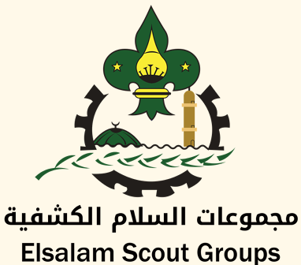
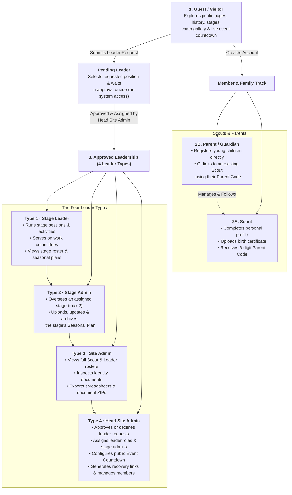
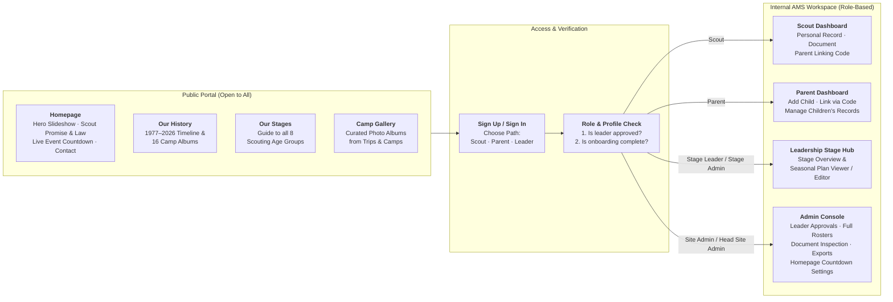
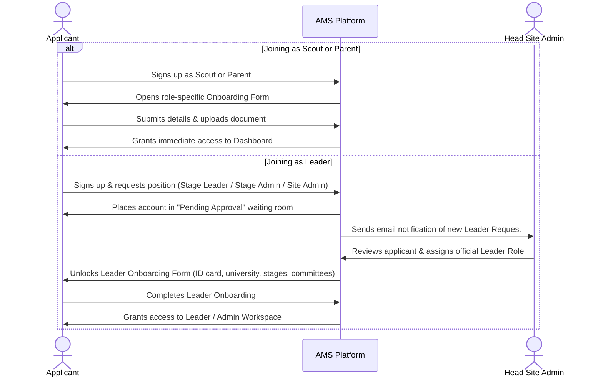
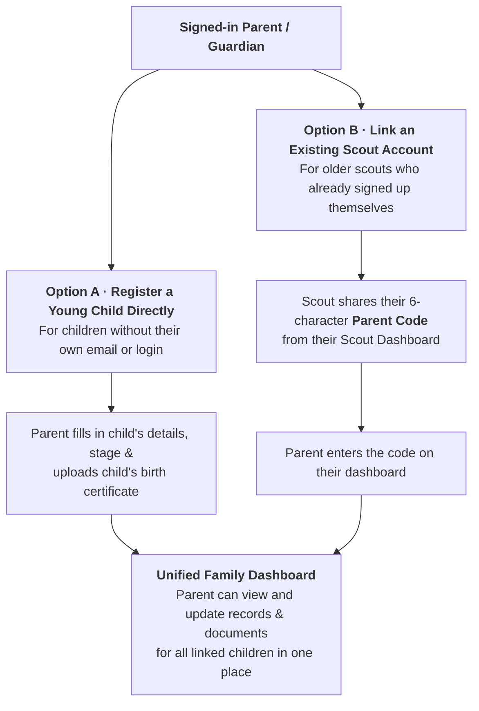
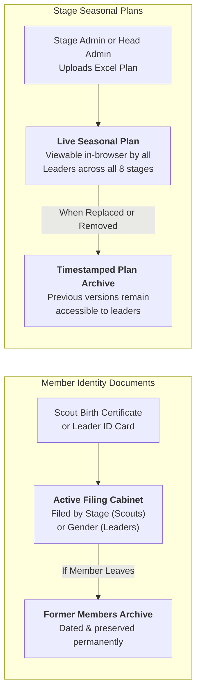
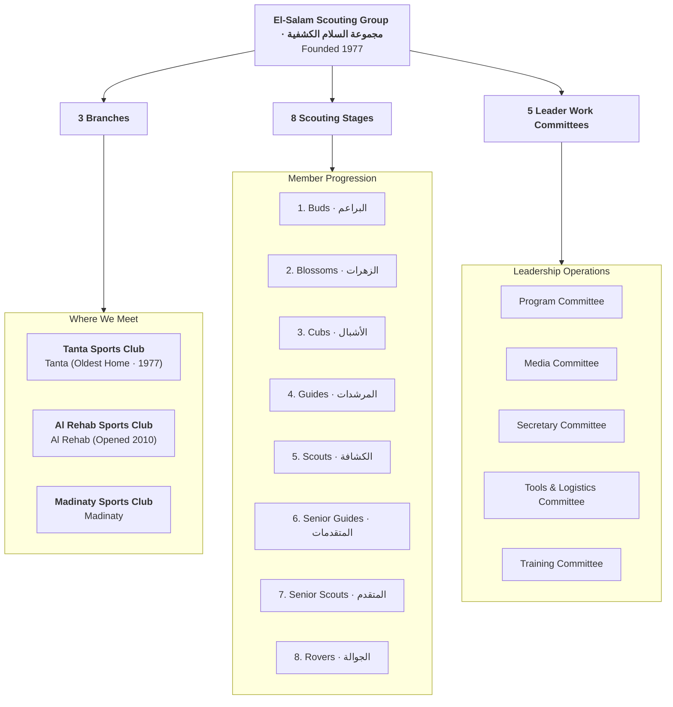

<h1>El-Salam Scouting Group · مجموعة السلام الكشفية</h1>

  <strong>Official Public Portal &amp; Association Management System (AMS)</strong> 
  <em>Character, Service &amp; Friendship · Since 1977</em>

  
  
  

---

## Executive Overview

The **El-Salam Scouting Group Platform** unifies the group's public identity and its internal operations into one bilingual (**Arabic & English**) digital system. It serves two core purposes:

1. **Public Portal** — Introduces visitors and families to El-Salam's heritage since 1977, its three branches (*Tanta, Al Rehab, and Madinaty*), the Scout Promise and Law, the eight age stages, upcoming group events, and a curated camp photo archive.
2. **Association Management System (AMS)** — Provides a secure, role-based workspace where scouts register, parents manage their children's memberships, stage leaders access seasonal plans, and administrators oversee rosters, identity documents, and leadership approvals.

---

## 1. User Hierarchy & Role Map

Every person interacting with the platform follows a structured progression—starting as a **Guest**, joining as a **Scout** or **Parent**, or applying for leadership and being approved into one of the **four Leader Roles**.

### Role Capabilities Summary

| User Tier | Role | How They Join | Key Responsibilities & Access |
| :--- | :--- | :--- | :--- |
| **Visitor** | **Guest** | Open access | Browses the homepage, history timeline, 8 scouting stages, camp photo albums, and live event countdown in Arabic or English. |
| **Member** | **Scout** | Self-registration | Completes scout onboarding (date of birth, stage, contact details, birth certificate) and receives a unique **Parent Code**. |
| **Family** | **Parent / Guardian** | Self-registration | Registers children who do not have their own accounts, or links to an existing Scout account via their **Parent Code**. |
| **Applicant** | **Pending Leader** | Leader signup request | Chooses a requested position and waits in a restricted holding state until reviewed by the Head Site Admin. |
| **Leader (1/4)** | **Stage Leader** | Approved by Head Admin | Completes leader profile (national ID, university/graduate details, stages served, committees) and accesses stage tools & seasonal plans. |
| **Leader (2/4)** | **Stage Admin** | Assigned by Head Admin | Manages a specific scouting stage (up to 2 Stage Admins per stage) and uploads/replaces that stage's **Seasonal Plan** workbook. |
| **Leader (3/4)** | **Site Admin** | Assigned by Head Admin | Accesses the full organization directory, verifies birth certificates and ID cards, and exports member data and bulk document archives. |
| **Leader (4/4)** | **Head Site Admin** | Root Administrator | Governs the entire system: approves leader requests, assigns all roles, sets the public Event Countdown, and manages member lifecycle. |

---

## 2. How the Site Works — End-to-End Platform Map

The platform is divided into a **Public Experience** for visitors and a **Protected Workspace** that adapts dynamically to the signed-in user's role.

---

## 3. Core Workflows

### A. Onboarding & Leadership Approval Flow

Unlike scouts and parents—who can complete onboarding immediately after creating an account—anyone applying as a **Leader** is placed in a protective holding state until verified by the **Head Site Admin**.

---

### B. Parent & Child Guardianship Workflow

Parents can manage all of their children in the group from a single guardian account using two flexible methods:

---

### C. Seasonal Plans & Document Archiving Workflow

To protect organizational records, the platform follows a **zero-data-loss policy**. Identity documents and seasonal plan spreadsheets are organized into structured folders and preserved automatically whenever changes occur.

---

## 4. Organizational Structure Map

El-Salam Scouting Group operates across **3 branches**, organizes members into **8 age-appropriate scouting stages**, and coordinates leadership through **5 specialized work committees**.

---

<h3>Connect with El-Salam Scouting Group</h3>

  <a href="https://ssg-website-ams.vercel.app"><strong>Official Website</strong></a>
  &nbsp;·&nbsp;
  <a href="https://ssg-website-ams.vercel.app/signup"><strong>Join the Group</strong></a>
  &nbsp;·&nbsp;
  <a href="https://ssg-website-ams.vercel.app/login"><strong>Member Sign In</strong></a>
  &nbsp;·&nbsp;
  <a href="https://www.instagram.com/ssg_elrehab_club"><strong>Instagram</strong></a>
  &nbsp;·&nbsp;
  <a href="https://www.facebook.com/share/1CAy5asLoZ/"><strong>Facebook</strong></a>
  &nbsp;·&nbsp;
  <a href="https://www.linkedin.com/company/elsalam-scout-groups/"><strong>LinkedIn</strong></a>
  &nbsp;·&nbsp;
  <a href="https://on.soundcloud.com/jM1XiXJjvlOwUbTR2j"><strong>SoundCloud</strong></a>

**مجموعات السلام الكشفية** · El-Salam Scout Groups  
Character, Service and Friendship · Since 1977

