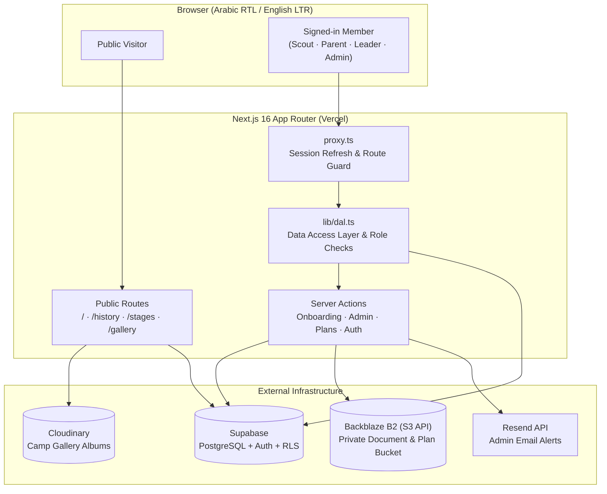
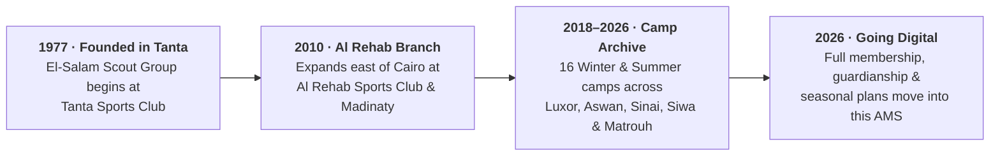

<div align="center">


<br />


<p>
  <a href="https://ssg-website-ams.vercel.app">
    
  </a>
  <a href="https://github.com/joe02692/SSG_website_AMS/actions">
    
  </a>
  
  
  
  
</p>

<p>
  <strong>Bilingual Public Portal &amp; Association Management System (AMS)</strong><br />
  Serving scouts, leaders, and families across <strong>Tanta · Al Rehab · Madinaty</strong>
</p>


</div>

---

## Overview

**SSG Website & AMS** combines the public-facing digital home of **El-Salam Scouting Group (مجموعة السلام الكشفية)** with a secure, role-based **Association Management System** in a single Next.js App Router codebase. Built Arabic-first (`RTL`) with instant cookie-based switching to English (`LTR`), it replaces spreadsheets and paper forms with structured digital records, identity document filing, parent-child linking, and seasonal plan management.

| Public Portal | Association Management System (AMS) |
| :--- | :--- |
| **Landing Page** — 23-photo hero slideshow, Scout Promise & 11-article Egyptian Scout Law, branches, and live **Event Countdown** | **Authentication & Onboarding** — Role-specific registration forms for Scouts, Parents/Guardians, and Leaders |
| **Our History (`/history`)** — Interactive rope timeline (1977–2026) and 16 winter/summer camp photo albums (2018–2026) | **Parent & Child Guardianship** — Parents can register children directly or link to an existing scout account via a 6-character **Parent Code** |
| **Our Stages (`/stages`)** — Breakdown of all 8 scouting stages from *Buds* (`baraem`) to *Rovers* (`jawala`) | **Document Filing Cabinet** — Presigned browser uploads to private **Backblaze B2** folders with automatic naming and non-destructive archiving |
| **Camp Gallery (`/gallery`)** — Dynamic photo albums powered by **Cloudinary** with automatic EXIF/GPS stripping | **Seasonal Plans (`/seasonal-plan`)** — In-browser Excel (`.xlsx`/`.xls`/`.xlsm`) viewer, stage-scoped uploads, and timestamped version archives |
| **Bilingual Experience** — Full Arabic (`RTL`) & English (`LTR`) localization without URL prefix bloat | **Admin Consoles (`/admin`, `/admin/scouts`)** — Leader request approvals, role & stage-admin assignments, roster exports, and bulk ZIP downloads |

---

## System Architecture



---

## Group Milestones



---

## Roles & Access Control

Authorization is enforced in **two independent layers**: application-level guards in [`lib/dal.ts`](lib/dal.ts) (`requireUser`, `requireApproved`, `requireCompletedDetails`, `requireSiteAdmin`, `requireHeadSiteAdmin`) and database-level **PostgreSQL Row-Level Security (RLS)** policies across 25 migrations.

| Role | Self-Serve? | Access & Capabilities |
| :--- | :---: | :--- |
| `scout` | Yes | Completes scout onboarding, uploads birth certificate, views personal profile and 6-character **Parent Code**. |
| `parent` | Yes | Completes guardian onboarding, registers young children directly (no child login required) or links existing scouts via their **Parent Code**. |
| `pending_leader` | Request at Signup | Holds **zero access** beyond `/pending`. Selects a requested position (*Stage Leader*, *Stage Admin*, or *Site Admin*) and waits for Head Site Admin approval. |
| `stage_leader` | Approved Only | Completes leader onboarding (ID card, university/graduate status, stages served, work committees), accesses `/dashboard/stage` and views `/seasonal-plan`. |
| `stage_admin` | Approved Only | All `stage_leader` permissions plus managing **Seasonal Plan** workbooks (upload, replace, archive) for their assigned stage (up to 2 Stage Admins per stage). |
| `site_admin` | Approved Only | Full read access to leader and scout rosters (`/admin`, `/admin/scouts`), identity document inspection, spreadsheet exports, and bulk document ZIP downloads. |
| `head_site_admin` | SQL-Assigned Only | Single root account. Approves/rejects leader requests, assigns roles and stage-admin stages, configures the live homepage **Event Countdown**, generates recovery links, and removes accounts. |

> [!IMPORTANT]
> `head_site_admin` is deliberately excluded from `ASSIGNABLE_ROLES` in the UI and Server Actions. It can only be granted manually in the Supabase SQL Editor, ensuring no application bug can ever mint a second root administrator.

---

## Backblaze B2 Filing Cabinet

All sensitive files (birth certificates, national ID cards, and seasonal plan workbooks) live in a single **private** Backblaze B2 bucket accessed exclusively via short-lived presigned S3 URLs (`lib/b2.ts`). Files are organized into human-readable folders (`lib/storage-paths.ts` & `lib/seasonal-plans.ts`):

```text
<B2_BUCKET>/
├── Members/
│   ├── Scouts/<Stage>/<Full Name> - Birth certificate.<ext>
│   ├── Leaders/
│   │   ├── Males/<Full Name> - ID card.<ext>
│   │   └── Females/<Full Name> - ID card.<ext>
│   └── Former members/
│       ├── Scouts/<YYYY-MM-DD> <Full Name> - Birth certificate.<ext>
│       └── Leaders/<YYYY-MM-DD> <Full Name> - ID card.<ext>
├── Seasonal Plans/
│   └── <Stage>/
│       ├── <Stage> seasonal plan.xlsx
│       └── Archive/<YYYY-MM-DD HH-mm> — <Original Name>.xlsx
└── _System/
    ├── Incoming/<profile_id>/...   # Temporary presigned browser upload staging
    └── Unfiled/...                 # Legacy unreferenced objects moved by tidy script
```

* **Zero Data Loss by Design:** Deleting a member moves their identity document to `Members/Former members/` rather than destroying it. Replacing or removing a seasonal plan moves the previous workbook to `Seasonal Plans/<Stage>/Archive/`.
* **Verified Uploads:** Browser uploads land in `_System/Incoming/<profile_id>/` first. Seasonal plans are magic-byte validated (`ZIP`/`OLE` header + SheetJS parse check) on the server before being filed.

---

## Tech Stack

| Layer | Technology |
| :--- | :--- |
| **Framework** | Next.js 16.3 (App Router, Server Actions, React Server Components) + React 19 + TypeScript 5 |
| **Styling & UI** | Tailwind CSS v4, custom SVG illustrations, responsive RTL/LTR layout |
| **Database & Auth** | Supabase (`@supabase/ssr`, PostgreSQL, Row-Level Security, DB-backed rate limiting) |
| **Private Storage** | Backblaze B2 via AWS S3 SDK v3 (`@aws-sdk/client-s3`, `@aws-sdk/s3-request-presigner`) |
| **Camp Media** | Cloudinary Admin API + `next/image` optimization |
| **Spreadsheets & ZIPs** | SheetJS (`@e965/xlsx`) for safe in-browser seasonal plan rendering & `jszip` for bulk document exports |
| **Email & Analytics** | Resend (transactional admin notifications) + Vercel Analytics |
| **CI / Deployment** | GitHub Actions (`typegen` → `tsc` → `eslint` → `next build` on Node 22) + Vercel |

---

## Getting Started

### 1. Clone & Install

```bash
git clone https://github.com/joe02692/SSG_website_AMS.git
cd SSG_website_AMS
npm install
```

### 2. Configure Environment Variables

Create a `.env.local` file in the project root (never committed to Git):

```dotenv
# Supabase
NEXT_PUBLIC_SUPABASE_URL=https://your-project.supabase.co
NEXT_PUBLIC_SUPABASE_ANON_KEY=your-anon-key
SUPABASE_SERVICE_ROLE_KEY=your-service-role-key

# Cloudinary (Camp Gallery)
NEXT_PUBLIC_CLOUDINARY_CLOUD_NAME=your-cloud-name
CLOUDINARY_API_KEY=your-api-key
CLOUDINARY_API_SECRET=your-api-secret
CLOUDINARY_GALLERY_FOLDER=gallery

# Backblaze B2 (Private Documents & Seasonal Plans)
B2_KEY_ID=your-b2-key-id
B2_APP_KEY=your-b2-application-key
B2_BUCKET=your-private-bucket-name
B2_ENDPOINT=https://s3.us-west-004.backblazeb2.com
B2_REGION=us-west-004

# Supabase Database Webhook → /api/webhooks/member-deleted (server-only).
# A long random string; the same value goes in the webhook's
# "x-webhook-secret" header in the Supabase dashboard.
MEMBER_WEBHOOK_SECRET=generate-a-long-random-string

# Site URL
NEXT_PUBLIC_SITE_URL=http://localhost:3000

# Email Notifications (Resend)
RESEND_API_KEY=re_xxxxxxxxxxxx
EMAIL_FROM="El-Salam Scouts <onboarding@yourdomain.com>"
ADMIN_NOTIFICATION_EMAILS=admin@example.com
```

### 3. Apply Database Migrations

Run the numbered SQL migrations in [`supabase/migrations/`](supabase/migrations/) in order (`0001` through `0025`) inside the Supabase SQL Editor:

1. `0001_profiles_and_roles.sql` → `0007_site_admin_hierarchy.sql` *(Core profiles, roles, hierarchy)*
2. `0008_member_details.sql` → `0015_leader_grants.sql` *(Scout & leader schemas, stages, storage policies)*
3. `0016_add_pending_role.sql` → `0019_rate_limits.sql` *(Leader approval queue, service role grants, rate limiting)*
4. `0020_leader_committees_and_join_year.sql` → `0025_parents_and_children.sql` *(Work committees, gender, stage admins, site event countdown, unique national IDs, parent & child guardianships)*

You can verify the database state anytime using the diagnostic queries in [`supabase/checks/`](supabase/checks/).

### 4. Run the Development Server

```bash
npm run dev
```

Open [http://localhost:3000](http://localhost:3000) in your browser.

---

## Scripts & Maintenance Utilities

| Command | Description |
| :--- | :--- |
| `npm run dev` | Start the Next.js development server on `http://localhost:3000` |
| `npm run build` | Build the production application |
| `npm run start` | Start the production server |
| `npm run lint` | Run ESLint across the codebase |
| `npx next typegen && npx tsc --noEmit` | Generate Next.js route types and run full TypeScript verification |
| `node scripts/set-b2-cors.mjs` | Configure Backblaze B2 native CORS rules to allow presigned browser `PUT` uploads |
| `node scripts/organize-backblaze.mjs` | Dry-run (or `--apply`) migration of legacy B2 objects into the `Members/` filing structure |
| `node scripts/upload-gallery.mjs "<folder>"` | Auto-orient, resize (`<= 2400px`), strip GPS/EXIF metadata, and upload camp photo subfolders to Cloudinary |

---

## Project Structure

```text
├── app/
│   ├── (auth)/             # Login, signup, forgot-password, reset-password
│   ├── admin/              # Site Admin & Head Admin consoles (/admin, /admin/scouts)
│   ├── api/cron/           # Scheduled maintenance endpoints
│   ├── auth/               # Auth Server Actions & email confirmation callback
│   ├── dashboard/          # Member hub, profile editor, stage roster, parent's children (/dashboard/children)
│   ├── gallery/            # Public camp album index & album viewer (/gallery/[album])
│   ├── history/            # Rope timeline & camp photo history
│   ├── onboarding/         # Role-tailored registration flow
│   ├── pending/            # Waiting room for unapproved leader requests
│   ├── seasonal-plan/      # Leader seasonal plan viewer, uploader & archive browser
│   ├── stages/             # Public guide to the 8 scouting stages
│   └── page.tsx            # Public landing page
├── components/
│   ├── admin/              # Event countdown settings
│   ├── auth/               # Auth forms & intro layout
│   ├── children/           # Parent code card, link-child form, remove-child button
│   ├── gallery/            # Album cards, lightbox & photo grid
│   ├── landing/            # Hero slider, Scout Promise/Law, timeline, contact section
│   ├── members/            # Leader/scout tables, role switcher, request reviewer, document preview
│   ├── onboarding/         # Dynamic question renderer & presigned document uploader
│   └── seasonal/           # Seasonal plan upload controls & archive drawer
├── lib/
│   ├── i18n/               # Arabic (RTL) & English (LTR) dictionaries and server/client helpers
│   ├── supabase/           # Server, browser, proxy & service-role Supabase clients
│   ├── b2.ts               # Backblaze B2 S3 client & presigned URL generators
│   ├── cloudinary.ts       # Cloudinary album & photo fetchers
│   ├── dal.ts              # Data Access Layer (cached user/profile/child queries & guards)
│   ├── onboarding.ts       # Schema-driven question definitions for Scout, Leader, Parent & Child
│   ├── roles.ts            # Role hierarchy constants & type guards
│   ├── seasonal-plans.ts   # Excel validation, SheetJS parser & B2 archive management
│   ├── site-content.ts     # Verified group milestones, camps, stages & contact links
│   ├── site-event.ts       # Cached homepage event countdown (Africa/Cairo timezone)
│   └── storage-paths.ts    # B2 folder conventions & non-destructive filing helpers
├── scripts/                # CLI utilities for B2 CORS, bucket organization & Cloudinary uploads
└── supabase/
    ├── checks/             # SQL verification scripts
    └── migrations/         # Ordered PostgreSQL schema & RLS migrations (0001 ... 0025)
```

---

<div align="center">


<p>
  <a href="https://ssg-website-ams.vercel.app/signup"><strong>Create an Account</strong></a>
  &nbsp;·&nbsp;
  <a href="https://ssg-website-ams.vercel.app/login"><strong>Sign In</strong></a>
  &nbsp;·&nbsp;
  <a href="https://ssg-website-ams.vercel.app"><strong>Visit the Website</strong></a>
  &nbsp;·&nbsp;
  <a href="https://www.instagram.com/ssg_elrehab_club"><strong>Instagram</strong></a>
  &nbsp;·&nbsp;
  <a href="https://www.facebook.com/share/1CAy5asLoZ/"><strong>Facebook</strong></a>
</p>

**مجموعات السلام الكشفية** · El-Salam Scout Groups

<sub>Character, service and friendship since 1977</sub>

</div>
